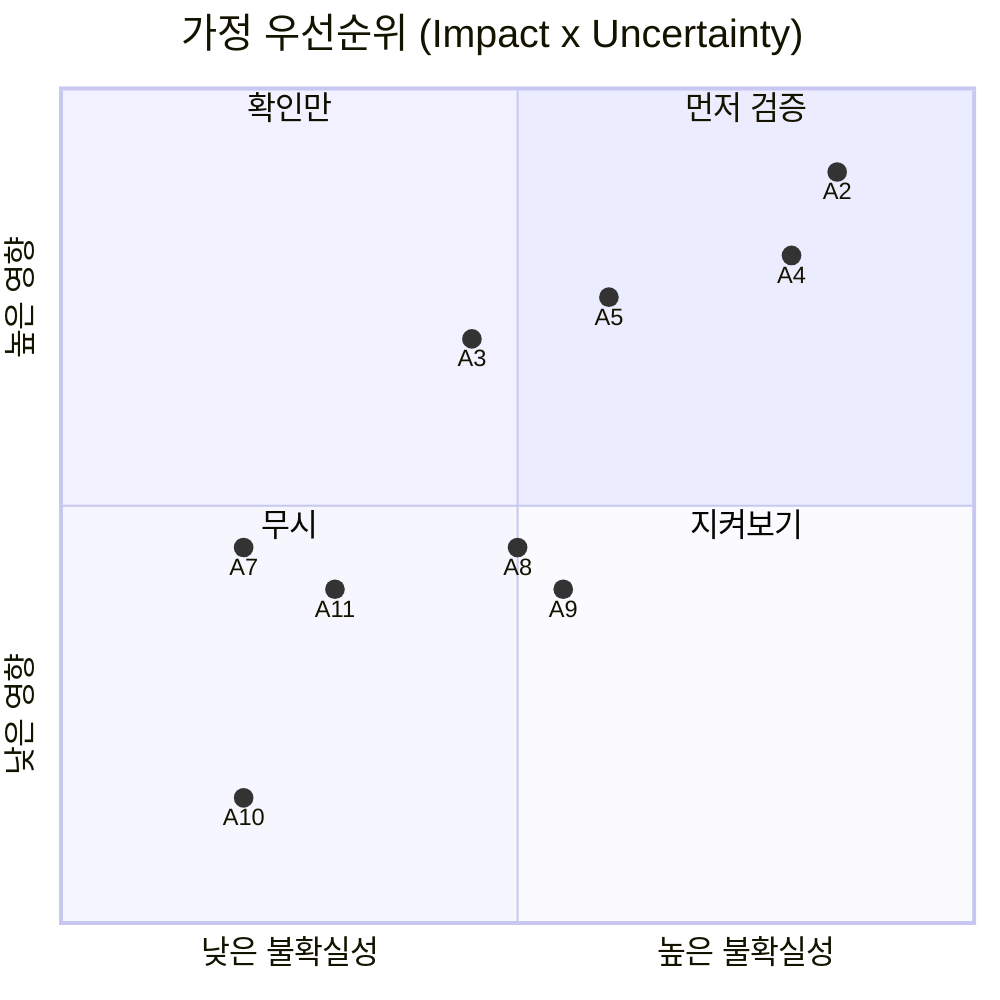

## Discovery Plan: 후원 알림 (스트리머·시청자)

**Date**: 2026-11-15
**Product Stage**: 기존 제품 (공모전 제출물, 마감 2026-11-19 23:59 KST, 11/19는 신규 기능 금지)
**Discovery Question**: 후원이 확정되면 스트리머와 시청자가 바로 알게 하려면 무엇이 가장 싸고, 남은 3.5일(11/15~11/18) 안에 넣을 가치가 있나?

실사용자 데이터 없음. 근거는 공모 원문 8절 체크리스트, README 절차, 현재 코드, 치지직·트위치의 공개 동작(기존 지식)이다.

### 지금 상태 (코드 대조)

| 누가 | 지금 아는 방법 | 근거 |
|---|---|---|
| 후원자 본인 | 결제 탭이 닫히면 시청 탭에 "후원이 반영되었습니다" 4초 | `DonationPanel.tsx` `DONATED_NOTICE_MS`, `donationChannel.ts`(BroadcastChannel) |
| 다른 시청자 | 후원 목록이 5초마다 조용히 바뀐다. 눈에 띄는 표시 없음 | `DonationPanel.tsx` `DONATION_POLL_MS = 5000` |
| 스트리머 (송출 중) | **알 방법이 없다.** 송출 화면에 후원·채팅 패널이 없다. 시청 화면을 따로 열거나 스튜디오 "후원"을 봐야 한다 | `PublishPage.tsx`(탭은 "브라우저로 송출"·"OBS로 송출"뿐) |

치지직·트위치는 두 방식을 함께 쓴다. ① 채팅에 후원 줄을 강조해 넣는다. ② 스트리머가 OBS 브라우저 소스로 알림 위젯을 띄워 영상에 합성한다. 그래서 시청자는 영상으로 알림을 보고, 스트리머는 위젯 소리와 대시보드로 안다.

### Ideas Explored

| # | 아이디어 | 누가 알게 되나 | 바뀌는 것 |
|---|---|---|---|
| 1 | 송출 화면 후원 알림: 새 후원 토스트와 최근 후원 목록 | 스트리머 | 웹만. 공개 `GET /broadcasts/:id/donations` 폴링과 이전 응답 비교 |
| 2 | 시청 화면 플레이어 위 후원 배너 | 모든 시청자 | 웹만. `DonationPanel`의 폴링 결과 비교 |
| 3 | 채팅 타임라인의 후원 줄 (다시보기 채팅에도 남음) | 채팅을 보는 모두 | DB(`ChatMessage`에 후원 연결) 또는 채팅 API에서 후원 병합 |
| 4 | 송출 화면 알림음 | 스트리머(다른 창을 보는 중에도). 시스템 소리를 송출하면 시청자도 듣는다 | 웹만 |
| 5 | 데스크톱 알림 (Notification API) | 스트리머(다른 창) | 웹만. 권한 요청 팝업 |
| 6 | OBS 브라우저 소스용 알림 위젯 URL | 영상에 합성되어 모든 시청자·다시보기 | 웹 페이지와 위젯 전용 토큰 URL(API) |
| 7 | 브라우저 송출 영상에 알림 합성 (canvas) | 영상에 합성 | 송출 파이프라인 변경 |
| 8 | 금액별 강조 단계 (색·표시 시간) | 1·2에 얹음 | 웹만 |
| 9 | 후원 목표 게이지 | 모든 시청자 | DB(목표 금액) |
| 10 | 다시보기 타임라인 후원 마커 | 다시보기 시청자 | 웹만(`approvedAt`과 `recordingStartedAt`) |

### Selected Ideas for Validation

- **1 송출 화면 알림**: 실제 빈 곳이다. 지금 스트리머는 송출 중에 후원을 알 방법이 없다.
- **2 시청 화면 배너**: "시청자 모두"를 API 변경 없이 채운다.
- **4 알림음**: PC 스트리머는 송출 탭이 아니라 공유한 창을 본다(A4). 화면 토스트만으로는 놓친다.
- **3 채팅 후원 줄**은 2와 비교용으로만 남긴다. 다시보기에도 남는 장점이 있지만 스키마 변경과 다시보기 채팅 동기화 테스트가 든다.

선택하지 않음: 5(권한 팝업이 심사 동선을 늘린다), 6(심사자가 OBS로 확인할 가능성이 낮다), 7(송출 파이프라인 위험, 모바일 성능), 8·9·10(1·2가 없으면 의미가 없다).

### Critical Assumptions

| # | Assumption | Category | Impact | Uncertainty | Priority |
|---|---|---|---|---|---|
| A1 | 후원 알림이 심사 점수에 직접 기여한다 | Viability | 높음 | **검증됨: 직접 기여 없음** | — |
| A2 | 남은 작업(#17 실기기 회귀·README, #150, #146, #105)을 밀어내지 않고 11/18 안에 넣는다 | Viability | 높음 | 높음 | **1 (leap of faith)** |
| A4 | PC 송출 중 스트리머는 송출 탭이 아니라 공유한 창을 보므로, 화면 토스트만으로는 놓친다 | Usability | 높음 | 높음 | **2 (leap of faith)** |
| A5 | 가려진 송출 탭에서도 폴링이 몇 초 안에 돈다 | Feasibility | 높음 | 중간 | **3 (leap of faith)** |
| A3 | 심사자가 후원할 때 스트리머 화면도 본다 | Value·Usability | 높음 | **부분 검증** | 4 |
| A8 | 모바일 송출·시청 화면에서 알림이 종료 버튼·플레이어 조작을 가리지 않는다 | Usability | 중간 | 중간 | 5 |
| A9 | 알림음이 시스템 소리 송출로 방송에 섞여도 괜찮다 | Value | 중간 | 중간 | 6 |
| A11 | 자동재생 정책이 알림음을 막지 않는다 | Feasibility | 중간 | 낮음 | 7 |
| A7 | 첫 로드와 폴링 복구 때 쌓인 후원을 한꺼번에 띄우지 않는다 | Usability | 중간 | 낮음 | 8 |
| A6 | 공개 후원 목록 API의 이전 응답 비교로 새 후원을 찾을 수 있어 API를 바꾸지 않는다 | Feasibility | 높음 | **검증됨: 참** | — |
| A10 | 후원자 본인에게 "후원이 반영되었습니다"와 배너가 겹쳐도 헷갈리지 않는다 | Usability | 낮음 | 낮음 | 9 |

### 검증 결과 (2026-11-15, 문서·코드 대조)

- **A1 공모 원문 대조**: 8절 도네이션 3항목은 대상·금액 선택과 테스트 결제, 서버 검증, 멱등 적립과 방송별 내역·합계뿐이다. 알림은 없다. 기여 경로는 하나다. 심사자가 후원을 확인하는 순간 "스트리머 화면에도 즉시 뜬다"를 보면 도네이션 흐름이 끝까지 이어져 보인다. → **점수가 아니라 시연 완성도 기능이다. 필수 작업보다 앞서지 않는다.**
- **A3 README 대조**: README 24행의 후원 절차는 일반 창에서 A가 송출하고 시크릿 창에서 B가 후원한다. 같은 PC에 두 창이 있으니 A 창에 알림이 뜨면 볼 수 있다. 단 심사자가 A 창으로 돌아가는지는 모른다. → **구현하면 README 24행에 "A의 송출 탭에 알림이 뜬다"를 한 줄 더한다.**
- **A5 사전 지식**: Chrome의 강한 타이머 제한(가려진 지 5분 뒤 1분에 한 번)은 WebRTC를 쓰는 페이지에 걸리지 않는다. 송출 탭은 WebRTC를 쓰므로 5초 폴링은 유지될 것으로 본다. Safari는 모른다. → E3에서 실측한다.
- **A6 코드 대조**: `DonationsService.list`는 `PAID`만, `approvedAt desc, id desc`로 최근 50건과 `id`·후원자 닉네임·금액·메시지·`method`를 준다. 비로그인도 200이다. 이전 응답에 없던 `id`가 새 후원이다. 5초 사이 50건을 넘으면 일부를 놓치지만 무시한다. → **API·DB 변경 없음.**

### WebSocket·SSE는 지금 필요 없다

① 문제: 알림 지연. 하지만 5초 폴링이 이미 돌고, 채팅은 1초 폴링이다. ② 대안: 기존 폴링 결과를 비교한다. ③ 얻는 것: 즉시 푸시, 요청 수 감소. ④ 비용: 게이트웨이, nginx 업그레이드 설정, 재연결·인증 처리. 3.5일 안에 운영 서버까지 바꾸는 위험이 크다. → 도입하지 않는다.

### Validation Experiments

| # | Tests Assumption | Method | Success Criteria | Effort | Timeline |
|---|---|---|---|---|---|
| E1 | A1·A3·A6 | 공모 원문·README·코드 대조 | — | 완료 | 11/15 |
| E2 | A2 | 남은 작업 시간 산정: #17·#150·#146·#105에 시간을 붙이고 11/18까지 남는 시간을 계산한다 | 여유 0.5일 이상이면 1·2, 1일 이상이면 4도 | 15분 | **11/15 통과**: #17에 쓸 시간이 충분하다(사용자 판단). 범위를 넓혀 [STORIES-donation-alert](./STORIES-donation-alert.md)로 뽑았다 |
| E3 | A4·A5·A9·A11 | 가려진 송출 탭 스파이크 (아래 상세) | 두 번 모두 10초 안에 감지, 소리 재생 | 45분 | 11/15~16 |
| E4 | A3·A8 | README 동선 리허설과 모바일 폭 스크린샷 (아래 상세) | README 한 줄로 알림을 본다. 겹침 없음 | 30분 | 구현 직후 (11/17) |

### Experiment Details

**E2 시간 산정**
- 가설: 필수 작업을 끝내고도 11/18까지 0.5일 이상 남는다.
- 방법: 열린 이슈마다 남은 시간을 적고 합한다. 1·2는 웹만 바꾸므로 테스트 포함 0.5일, 4는 0.25일로 잡는다.
- 판정: 여유 < 0.5일이면 하지 않는다. 0.5~1일이면 1·2만. 1일 이상이면 1·2·4.

**E3 가려진 송출 탭 스파이크**
- 가설: PC Chrome에서 다른 창을 공유하며 송출하는 동안, 가려진 송출 탭의 폴링이 10초 안에 새 후원을 찾고 알림음을 낸다.
- 방법: 송출 탭에 임시로 `console.log(Date.now())` 폴링과 `new Audio()` 재생을 붙인다. 실제로 다른 창을 공유해 송출하고 송출 탭을 가린다. 1분 뒤와 6분 뒤(강한 제한이 걸리는 5분을 넘긴 시점)에 B로 라임 후원을 보낸다. 후원 시각과 감지 시각의 차이를 적는다. 시스템 소리 송출을 켠 경우 시청 탭에서 알림음이 들리는지도 적는다. 가능하면 Mac Safari도 한 번.
- 판정: 둘 다 10초 안이면 4를 넣는다. 6분 뒤가 10초를 넘으면 4는 빼고, README에 "송출 탭을 보고 있을 때 알림이 뜬다"고 쓴다.

**E4 동선 리허설과 모바일 폭**
- 가설: README 24행 절차에 한 줄을 더하면 심사자가 A 창에서 알림을 본다. 알림이 모바일 화면의 조작을 가리지 않는다.
- 방법: README 절차를 PC 한 대에서 그대로 따라 하며 A 창으로 돌아갔을 때 알림이 남아 있는지 본다(표시 시간이 짧으면 놓친다). Playwright로 390px 폭의 송출·시청 화면에 알림이 뜬 상태를 찍는다.
- 판정: 알림이 사라진 뒤 돌아와도 송출 화면의 최근 후원 목록에 남아 있으면 통과. 종료 버튼·플레이어 조작과 겹치면 위치를 옮긴다.

### Discovery Timeline

| 날짜 | 할 일 |
|---|---|
| 11/15 (일) | E2 시간 산정. 여유가 있으면 E3 스파이크 |
| 11/16 (월) | E3 판정 → 구현 (1·2, 조건부 4) |
| 11/17 (화) | E4 리허설, README 24행과 8절 갱신 |
| 11/18 (수) | 여유분. 넘치면 여기서 멈춘다 |
| 11/19 (목) | 신규 기능 금지 |

### Decision Framework

- E2 여유 < 0.5일 → **하지 않는다.** triage에서 "하지 않을 것"으로 적고 제출 뒤 백로그로 둔다.
- E2 통과, E3 성공 → 1·2·4를 한 이슈로 만든다.
- E2 통과, E3 실패 → 1·2만 하고 README에 한계를 쓴다. 데스크톱 알림(5)으로 대신하지 않는다(권한 팝업이 심사 동선을 늘린다).
- 3(채팅 후원 줄)과 6(OBS 위젯)은 제출 뒤로 미룬다.
- 1·2·4는 웹만 바뀌고 DB·API가 그대로다. 그래서 `docs/agents/pm-skills.md` 크기표로는 "방향이 정해진 기능"이다. 다음 단계는 `red-team-prd`·`write-prd`가 아니라 `/pm-execution:write-stories` → 이슈다.

### 관련 관찰 (범위 밖)

송출 화면에는 채팅도 없다. 스트리머는 송출 중에 채팅을 읽으려면 시청 화면을 따로 열어야 한다. 공모 원문에 채팅 항목이 없어 이 문서에서는 다루지 않는다.
