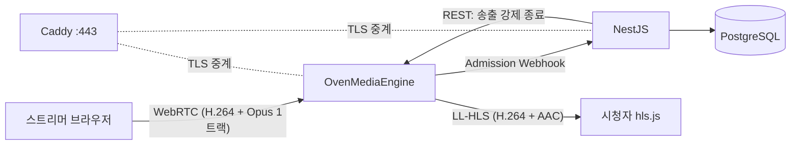
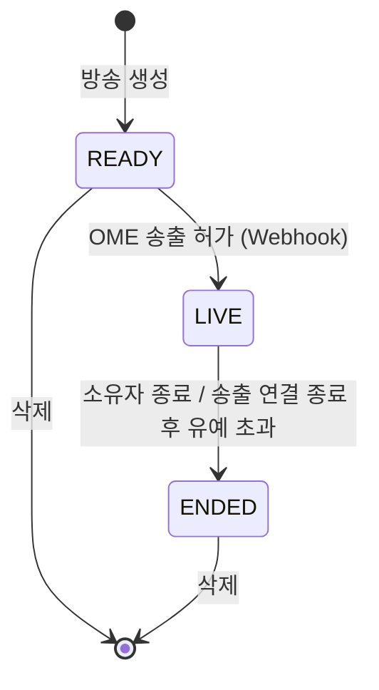
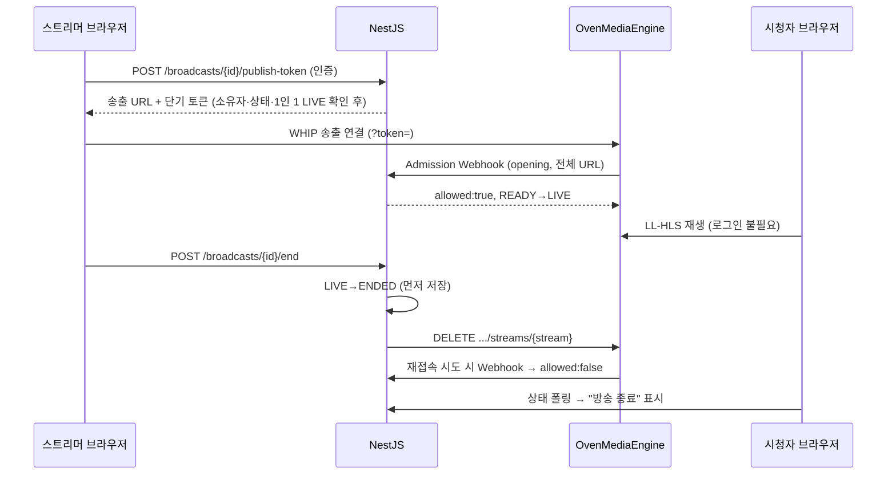

## Product Requirements Document: 실시간 방송 플랫폼

**Author**: keunhyeok
**Date**: 2026-11-09
**Status**: Draft
**마감**: 2026-11-19(목) 23:59 KST — 남은 기간 11일

---

### 1. Summary

브라우저만으로 PC(화면 공유 + 마이크 + 탭/시스템 소리)와 모바일(카메라 + 마이크) 라이브 방송을 송출하고, 누구나 로그인 없이 시청하는 웹 서비스를 만든다. 공모전 평가는 **필수 기능의 완결성과 서버 측 인가 검증**을 가장 크게 보므로, 1차 목표는 필수 4개 영역을 배포 URL에서 끊김 없이 시연하는 것이다. 선택 기능은 필수 기능이 끝난 뒤 비용이 낮은 순서로 붙인다.

### 2. Contacts

| 역할 | 이름 | 비고 |
|---|---|---|
| 개발·기획 | keunhyeok | 1인 개발 |
| 평가 | 공모전 심사자 | README만 보고 기능을 확인한다 |

### 3. Background

- **왜 지금**: 공모전 제출물이다. 심사자는 README에 적힌 URL과 테스트 계정으로 직접 송출·시청·종료를 해 본다. 접속이나 테스트 로그인이 안 되면 감점된다.
- **핵심 기술 제약**
  - 화면 공유 오디오(`getDisplayMedia({audio:true})`)는 브라우저와 OS에 따라 다르다. Chrome/Edge는 탭 소리를 모든 OS에서 지원한다. 시스템 소리는 Windows(및 ChromeOS)에서 지원하고, macOS는 Chrome 141+ · macOS 14.2+부터 지원한다는 2차 출처만 있다 (C4에서 직접 확인). Safari와 Firefox는 화면 공유 오디오를 지원하지 않는다.
  - 카메라·마이크·화면 캡처는 HTTPS에서만 동작한다. 배포 환경은 처음부터 HTTPS여야 한다.
  - 모바일 브라우저는 화면이 꺼지거나 앱이 백그라운드로 가면 캡처가 멈춘다.
- **송출 방식 비교**

| 방식 | 지연 | 다중 시청자 | 녹화 | 구현·운영 부담 | 판단 |
|---|---|---|---|---|---|
| WebRTC P2P(mesh) | 낮음 | 송출자 업로드가 시청자 수만큼 늘어 수 명에서 한계 | 어려움 | 시그널링 직접 구현 | 제외 |
| **OvenMediaEngine (자체 호스팅)** | LL-HLS 2~5초 / WebRTC 1초 미만 | 서버가 분배 | 서버 내장 | UDP 포트·TLS·코덱 직접 관리 | **채택** |
| WebRTC SFU (LiveKit Cloud) | 1초 미만 | SFU가 분배 | Egress(별도 비용) | SDK 제공, 외부 서비스 의존 | **복귀안** (8.1 컷 규칙) |
| MediaRecorder → WebSocket → FFmpeg → HLS | 5~15초 | 정적 서빙 | 쉬움 | 트랜스코딩 서버 직접 구현 | 제외 |

### 4. Objective

**목표**: 심사자가 README만 보고 10분 안에 PC·모바일 송출 → 다른 기기 시청 → 종료, 그리고 권한별 허용·거절을 모두 확인할 수 있다.

| Key Result | 측정 방법 | 목표 |
|---|---|---|
| KR1. 필수 시나리오 통과율 | 8.3 인수 시나리오를 배포 URL에서 수행 | 100% |
| KR2. 송출→시청 지연 | 송출 화면의 시계와 시청 화면을 나란히 촬영 | LL-HLS 5초 이하 |
| KR3. 인가 매트릭스 | 비로그인/소유자/타인 × 각 API를 자동 테스트로 검증 | 거절 케이스 전부 401/403 |
| KR4. 재시작 후 조회 | 서버 재시작 후 방송 목록·상세 조회 | 데이터 유실 0건 |
| KR5. 종료 시 송출 중단 | 종료 API 호출 후 시청 화면 | 10초 안에 재생 중단 + "종료됨" 표시 (LL-HLS 버퍼 포함) |

### 5. Market Segments

| 세그먼트 | 상황 | 대표 기기 |
|---|---|---|
| PC 스트리머 | 게임·작업 화면을 소리와 함께 바로 송출하고 싶다. OBS 설치·설정은 부담이다 | Windows/macOS + Chrome/Edge |
| 모바일 스트리머 | 밖에서 휴대폰 카메라로 바로 방송하고 싶다 | iOS Safari, Android Chrome |
| 시청자 | 링크만 받아 가입 없이 바로 보고 싶다 | 모든 기기 |
| 심사자 (1차 사용자) | 제한된 시간에 기능과 권한 검증을 빠짐없이 확인해야 한다 | PC 1대 + 휴대폰 1대 |

### 6. Value Propositions

**PC 스트리머**
- **Who**: 화면을 공유하며 말로 설명하는 사람
- **Why**: 화면, 마이크, 게임/영상 소리를 한 번에 내보내야 한다
- **What before**: OBS 설치 → 장면·오디오 소스 설정 → 스트림 키 입력
- **How**: 브라우저에서 "방송 시작" → 화면/탭 선택 → "탭 소리 공유" 체크 → 마이크 허용
- **What after**: 설치 없이 30초 안에 화면+소리 방송이 켜진다
- **Alternatives**: OBS + 치지직/유튜브. 품질은 높지만 진입 장벽이 크다

**모바일 스트리머**
- **Who**: 휴대폰만 들고 있는 스트리머
- **Why**: 현장을 바로 보여주고 싶다
- **What before**: 전용 앱 설치·가입
- **How**: 모바일 브라우저에서 로그인 → 방송 생성 → 카메라·마이크 허용 → 시작 (전·후면 전환 지원)
- **What after**: 앱 없이 웹으로 즉시 송출한다
- **Alternatives**: 플랫폼 공식 앱

**시청자**
- **Who**: 링크를 받은 누구나
- **Why**: 가입 없이 바로 보고 싶다
- **What before**: 가입·로그인 요구에 이탈
- **How**: 목록에서 "LIVE" 방송 선택 → 바로 재생
- **What after**: 로그인 없이 수 초 지연으로 시청한다 (치지직과 같은 LL-HLS 방식)
- **Alternatives**: 기존 플랫폼

**심사자**
- **Who**: 공모전 평가자
- **Why**: 기능과 권한 검증을 빠르고 확실하게 확인해야 한다
- **What before**: 계정 만들고, 실행 환경 세팅하고, 시나리오를 추측
- **How**: README의 URL → "테스트 계정으로 로그인" 버튼(스트리머 A / 사용자 B) → README 시나리오 순서대로 확인
- **What after**: 계정 생성 없이 소유자·타인·비로그인 케이스를 모두 재현한다
- **Alternatives**: 없음 (README 품질이 곧 평가)

### 7. Solution

#### 7.1 기능 범위

| 영역 | 기능 | 우선순위 |
|---|---|---|
| 인증 | 회원가입·로그인·로그아웃, 인증 상태 유지, 테스트 계정 원클릭 로그인 | P0 |
| 방송 관리 | 방송 생성(제목·설명)·수정·삭제, 공개 목록(LIVE/방송 준비 중/ENDED 필터, 받아 온 목록 안에서 제목·스트리머 닉네임 검색), 내 방송(방송 준비 중 포함), 상세 | P0 |
| PC 송출 | 화면 공유 + 마이크 + 탭/시스템 소리, 시작·종료, 마이크 음소거 | P0 |
| 송출 사전 점검 | 마이크·화면 오디오 레벨 미터 2개, 화면 오디오 없음 경고 + "다시 선택", Chrome/Edge 외 브라우저 경고 (PRE-MORTEM T4) | P0 |
| 모바일 송출 | 카메라 + 마이크, 전·후면 전환, 시작·종료, Screen Wake Lock으로 화면 꺼짐 방지, 권한 거부 안내 화면 (T5) | P0 |
| 시청 | 비로그인 시청(LL-HLS: iOS는 네이티브 HLS, 그 외 hls.js), LIVE/ENDED 상태 표시, 상태 5초 폴링으로 종료 시 자동 중단 (T9) | P0 |
| 운영 | 자동 재기동, 다운 감시 알림, 녹화 디스크 상한, DB 일일 덤프 (T6, 7.10) | P0 |
| 댓글 | 방송별 댓글 작성·목록·수정·삭제, 작성자 권한 검증. 방송이 끝난 뒤에 쓴다. 방송 전·중에는 채팅(작성만, 수정·삭제 없음)을 쓴다(#91) | P1 |
| 녹화·다시보기 | OME 녹화 기능으로 저장, 목록·상세·재생 | P2 |
| 도네이션 | 테스트 결제, 서버 승인 검증, 멱등 적립, 방송별 내역·합계. 결제 화면은 새 탭에서 열어 시청 탭의 영상을 멈추지 않고, 결제가 끝나면 결제 탭을 닫고 시청 탭이 반영을 알린다([PRD-lime](./PRD-lime.md) 7.1·7.2) | P2 |
| 라임 | 현금 1:1 단위 "라임"을 테스트 결제로 충전하고, 시청 화면을 떠나지 않고 잔액에서 차감해 후원한다. 직접결제 후원은 유지한다(공모 원문의 승인 시 후원 대상 검증은 직접결제가 충족). 상세는 [PRD-lime](./PRD-lime.md) | P2 |
| 채널 설정 | 스트리머가 "내 채널" 화면(`/studio/channel`)에서 기본 대기 이미지 한 장(JPEG·PNG·WebP, 2MB 이하)을 올리고 바꾸고 지운다. 그 스트리머의 모든 방송이 방송 준비 중(`READY`) 카드와 시청 화면에 이 이미지를 쓰고, `LIVE`·`ENDED`는 송출 화면 캡처 썸네일을 먼저 쓴다(#63). 방송별 대기 이미지는 두지 않는다 | P2 |
| 팔로우 | 시청 화면·채널 페이지에서 스트리머 팔로우·언팔로우, 시청 쪽 화면 왼쪽 패널에 팔로우한 스트리머의 LIVE 여부(비로그인은 LIVE 중인 방송), 좁은 화면은 `/following`. 스튜디오·마이페이지는 패널 대신 그 영역의 메뉴를 둔다. 알림은 하지 않는다(8.2) | P2 |
| 마이페이지 | 라임 충전·후원 원장, 보낸 후원(두 수단 합계), 프로필(소개·프로필 이미지·닉네임, 테스트 계정은 닉네임 고정). 스튜디오에 받은 후원 합계(방송을 지워도 유지)와 팔로워 목록. 상세는 [PRD-mypage](./PRD-mypage.md) | P2 |
| 채널 페이지 | `/channels/:id`: 누구나 보는 스트리머 프로필·팔로워 수·LIVE·공개 방송 목록. 방송 카드·시청 화면·팔로우 패널·헤더 메뉴의 닉네임에서 들어간다. 팔로워 목록은 공개하지 않는다([PRD-mypage](./PRD-mypage.md)) | P2 |
| OBS 송출 | 송출 화면에서 방송별 WHIP URL을 발급해 OBS 서버 칸에 붙여 넣는다. 브라우저 송출의 추가 방법이고 서버 송출 경로는 같다(#89). 채널 스트림 키는 쓰지 않는다(8.2). OBS 실기 판정은 #88 | P3 |

#### 7.2 아키텍처

| 구성 요소 | 선택 | 이유 |
|---|---|---|
| 미디어 서버 | OvenMediaEngine v0.21.0 (`ovenmedialabs/ovenmediaengine`, arm64 이미지 있음) | 치지직과 같은 LL-HLS를 기본 지원하고, WebRTC 송출·시청·녹화까지 한 서버로 해결한다 |
| 백엔드 | NestJS (TypeScript) + Prisma | Guard로 "로그인 확인 → 소유자 확인"을 선언한다. OME Admission Webhook을 받는다 |
| DB | PostgreSQL | 사용자, 방송 기록, 세션 |
| 프론트 | React (TypeScript) + hls.js + OvenLiveKit-Web | 주력 스택. 송출은 OvenLiveKit-Web의 WHIP(기본 H.264), 재생은 iOS 네이티브 HLS / 그 외 hls.js 저지연 모드 |
| 배포 | VPS 한 대 + Docker Compose + Caddy | 혼자 운영 가능한 최소 구성. Caddy가 TLS를 맡고 웹·API·OME 시그널링·LL-HLS를 한 도메인으로 중계한다 |

- **방화벽**: 443/TCP(Caddy), OME ICE `10000-10003/udp`, Direct TCP ICE `10000/tcp`, 내장 TURN `3478/tcp`. OME 시그널링·LL-HLS(`3333`/TLS `3334`)는 Caddy 443 뒤로 중계한다. 내장 TURN은 TCP만 지원하고 443 TLS TURN 옵션은 문서에 없다. 3478을 막는 통신망은 S6에서 판정한다.
- **WHIP ICE (S6 실측)**: 송출 URL은 `.../app/<stream>?direction=whip&transport=all`로 쓰고, OvenLiveKit `connectionConfig`에 `iceTransportPolicy: 'all'`을 넣는다. OME는 `transport=all`일 때만 TURN 주소를 응답 `Link` 헤더로 알려 준다. 쿼리가 없으면 UDP와 직접 TCP 10000 후보만, `transport=tcp`면 직접 TCP 후보만 준다. 반대로 OvenLiveKit은 `Link` 헤더로 TURN을 받고 로컬 정책이 없으면 `relay`로 강제해, UDP가 되는 망에서도 TURN을 거친다. 내장 TURN 계정은 기본값 `ome`/`airen`이 `Link` 헤더에 그대로 나가므로 S5에서 바꿀지 판단한다.
- **코덱**: 송출은 **H.264로 고정**한다. OME 서버에는 코덱 강제 설정이 없고 SDP 협상으로 정해지므로, 클라이언트가 고른다. OvenLiveKit-Web의 WHIP 송출은 기본값이 H.264다 (`preferredVideoFormat`). VP8이 들어오면 영상 bypass 상태의 LL-HLS에 영상이 나오지 않는다. 오디오는 OME 기본 `bypass_stream` 프로필이 Opus → AAC만 변환한다 (LL-HLS는 AAC만 지원, CPU 부담 낮음).
- **LL-HLS 세그먼트 (#102 실측)**: `ChunkDuration 0.5`, `PartHoldBack 1.5`, `SegmentDuration 4`, `SegmentCount 15`(플레이리스트 창 60초). 방송 직후 시청자는 첫 세그먼트가 닫힐 때까지 기다린다. OME가 미디어 플레이리스트 요청을 그때까지 붙잡아 두기 때문이다. 세그먼트는 키프레임에서만 잘리고, 브라우저 송출의 키프레임은 약 3초 간격이다(PC Chrome 카메라 3.0초, 화면 공유 3~4초, Android Chrome 카메라 3.0초). 로컬 측정에서 송출 연결부터 첫 `playing`까지 6초 세그먼트는 평균 14.2초, 4초 세그먼트는 11.1~11.6초였다. 3초 세그먼트는 9.6초까지 줄었지만 시작의 약 1/3에서 hls.js가 오디오 파트를 반복해 받다가 멈춰, 쓰지 않는다. 남은 대기의 약 5초는 세그먼트와 무관하다. OME가 첫 영상 키프레임을 받기까지(약 4초)와 스트림 준비(약 1초)다. 시청 화면의 404 재시도 간격(2초)은 이 대기에 영향이 없어 그대로 둔다.

#### 7.3 데이터 모델 (초안)

- `User`(스트리머) 1 : N `Broadcast` (`streamerId`, 제목, 설명, 상태, 시작·종료 시각, 녹화 경로)
- `User`(팔로워) N : M `User`(스트리머)를 `Follow`(`followerId`, `streamerId` 복합 기본 키)로 잇는다. 어느 쪽 사용자가 지워져도 팔로우가 함께 지워진다. "지금 LIVE"는 따로 저장하지 않고 그 스트리머의 `LIVE` 방송으로 읽는다.
- 채널 설정(기본 대기 이미지)은 `User`의 `standbyImageExt`(`jpg`·`png`·`webp`)와 `standbyImageUpdatedAt`에 둔다. 파일은 썸네일 폴더의 `users/<사용자 id>/standby.<확장자>`이고, 방송을 지워도 남는다. 방송은 송출할 때마다 새로 만들므로 방송 단위로 두면 매번 다시 올려야 한다(#63).
- `Broadcast` 1 : N `ChatMessage`(`authorId`, 본문, `createdAt`, 인덱스 `(broadcastId, createdAt)`)는 방송 전·중 채팅, 1 : N `Comment`(`authorId`, 본문, `createdAt`, `updatedAt`)는 방송 후 댓글이다. 채팅은 고치지 않아 `updatedAt`이 없다. 방송이나 작성자를 지우면 둘 다 함께 지워진다. #91 마이그레이션이 그 전의 `Comment` 중 방송 종료(`endedAt`) 전에 쓴 행과 아직 끝나지 않은 방송의 행을 같은 id로 `ChatMessage`에 옮겼다.
- 프로필은 `User.bio`(0~200자)와 `avatarExt`·`avatarUpdatedAt`에 둔다. 파일은 `users/<사용자 id>/avatar.<확장자>`이고 기본 대기 이미지와 같은 "사용자 이미지 슬롯" 코드로 저장한다(PRD-mypage 7.1).
- `Channel`(스트림 키)은 두지 않는다. OBS는 방송별 WHIP URL로 송출하므로 스트림 키가 필요 없다(#89, 8.2).
- 도네이션의 후원 대상 스트리머(공모 원문의 "방송자")는 `Donation.recipientId`에 둔다. 후원을 만들 때 `Broadcast.streamerId`를 복사한다. 방송을 지우면 `broadcastId`만 비고(#114) 받은 사람은 남아, 스트리머의 받은 후원 합계가 줄지 않는다(#118, PRD-mypage 7.1). 처음에는 `Broadcast.streamerId`로 충분하다고 보았으나 #114 이후 방송을 지우면 받은 사람을 잃게 되어 바꿨다.
- 라임: `User.limeBalance`(현재 잔액, 조건부 UPDATE로만 바꾼다), `LimeCharge`(충전 주문, `orderId`·`paymentKey` UNIQUE), `LimeLedger`(원장, `(kind, refId)` UNIQUE, `balanceAfter`). `Donation.method`(TOSS·LIME)로 두 후원 수단을 한 내역·합계에 담는다.
- 상세 스키마는 착수 시 설계 문서로 분리한다.

#### 7.4 방송 상태

- 상태 전이는 서버만 한다. 클라이언트는 요청만 보낸다.
- `LIVE`에서 삭제를 요청하면 서버가 먼저 종료 처리한 뒤 삭제한다.
- `ENDED`는 다시 `LIVE`로 돌아가지 않는다. 다시 방송하려면 새 방송을 만든다.
- **종료 시 송출 중단**: NestJS가 **먼저** DB 상태를 `ENDED`로 저장하고, **그다음** OME 관리 API `DELETE /v1/vhosts/{vhost}/apps/{app}/streams/{stream}`으로 송출 연결을 끊는다. OME는 끊긴 송출자의 재접속을 막지 않으므로, 재접속은 Webhook이 `ENDED`를 보고 거절한다. 순서가 바뀌면 그 사이 재접속이 허용될 수 있다.
- **송출 허가 규칙 (Webhook)**: 송출 토큰이 유효하고 소유자이며, 다음 중 하나일 때만 허용한다.
  - `READY` (첫 송출)
  - `LIVE`이면서 현재 송출 연결이 없고 유예 시간(30초) 안 (새로고침·순간 끊김 후 재접속)
  - `ENDED` 방송과 유예를 넘긴 재접속은 거절한다.
- **1인 1 LIVE**: 한 사용자는 동시에 하나의 방송만 `LIVE`로 둔다. 송출 토큰 발급과 Webhook 두 곳에서 확인하고, 위반 시 토큰 발급은 409 + "기존 방송을 종료하세요"를 돌려준다.
- **비정상 종료**: 송출자 탭이 닫히거나 네트워크가 끊기면 OME가 `closing` Webhook으로 알린다(알림만, 응답은 `{}`). 유예 시간 30초 안에 다시 연결되지 않으면 `ENDED`로 바꾼다.
- **송출 연결 생성·종료 (클라이언트)**: 시작 시 WebRTC 송출 연결을 만들고, 종료(직접 종료·서버 강제 종료·페이지 이탈) 시 PeerConnection을 닫고 모든 미디어 트랙을 `stop()`한다. 브라우저의 "화면 공유 중"·카메라 표시등이 꺼지는 것까지 종료로 본다. 브라우저의 "공유 중지" 버튼을 누른 경우(트랙 `ended`)도 종료 API를 호출한다.
- **좀비 방송 정리 (T8)**: Webhook이 누락되거나 순서가 바뀔 수 있으므로, 30초마다 OME 스트림 목록과 DB의 `LIVE` 방송을 대조해 송출이 없는 방송을 유예 후 `ENDED`로 바꾼다. Webhook 처리는 멱등하게 만든다 (같은 이벤트가 두 번 와도 결과가 같다).
- **시청자 종료 감지 (T9)**: 시청 화면은 방송 상태를 5초마다 조회하고, hls.js 치명적 오류(네이티브 HLS 경로는 `<video>`의 `error`·`stalled`) 때도 즉시 다시 조회한다. `ENDED`면 재생을 정리하고 "방송 종료"를 표시한다.
- **목록 노출**: 공개 목록은 `LIVE` → `READY` → `ENDED` 순서다. `READY`는 만든 지 24시간 안인 것만 "방송 준비 중"으로 보여, 시청자가 방송 전부터 목록에서 들어와 기다릴 수 있다. 24시간이 지난 `READY`는 공개 목록에서만 빠지고 소유자의 "내 방송"에는 남는다(자동 종료·삭제 없음). 팔로우 목록은 `LIVE`만 보인다. `READY` 시청 화면은 "방송 준비 중입니다."를 안내한다(#90).
- **재생 경로 분기**: `window.MediaSource`가 있고 hls.js가 지원되는 브라우저는 hls.js, 없는 브라우저(iPhone Safari)는 `<video src>` 네이티브 HLS로 보낸다. hls.js는 iOS에서 17.1+에서만 동작하므로 iOS는 네이티브로 보낸다. `canPlayType('application/vnd.apple.mpegurl')`만으로는 나눌 수 없다. 데스크톱 Chrome 156도 `'maybe'`를 돌려주기 때문이다(#10 실측).

#### 7.5 인가 규칙

송출 권한은 **OME Admission Webhook**으로 강제한다. 브라우저는 소유자에게만 발급되는 송출 토큰을 송출 URL의 **쿼리스트링**(`?token=`)에 담아 OME에 연결한다. OME는 연결마다 전체 URL을 NestJS에 보내 허용 여부를 묻는다 (HTTP 헤더는 전달되지 않는다). NestJS가 토큰·소유자·방송 상태(7.4 송출 허가 규칙)를 확인해 `allowed:false`를 돌려주면 송출이 시작되지 않는다. 시청은 로그인 없이 허용한다.

- **송출 토큰**: 방송 하나와 스트리머 하나에 묶이고, 연결할 때(재접속 포함)만 검사한다. 송출 중에 만료돼도 연결은 끊기지 않는다. 수명은 송출 방법마다 다르다(`apps/api/src/publish/publish-token.ts`의 `PUBLISH_TOKEN_TTL_SECONDS`).
  - 브라우저: 5분. 브라우저는 자동 재접속을 하지 않고, 새로고침하거나 다시 시작할 때 새로 발급받는다.
  - OBS(`POST /api/broadcasts/:id/publish-token` 본문 `{"client":"obs"}`): 12시간(#89). OBS는 서버 칸에 붙여 넣은 URL로 자동 재접속하고, Webhook은 재접속에도 토큰을 검사한다. 5분이면 발급 5분 뒤에 생긴 짧은 끊김에서 30초 유예 재접속이 `invalid token`으로 거절되고 방송이 끝난다. ENDED는 되돌아오지 않으므로 수명이 늘어 위험이 커지는 곳은 방송 시작 전(READY)에 URL이 유출되는 경우 하나다. AWS IVS의 WHIP 송출 토큰(참가자 토큰)도 기본 12시간이다.
- **Webhook 신뢰**: `X-OME-Signature`(HMAC-SHA1, `SecretKey`)를 검증한다.
- **fail-closed**: NestJS가 시간 안에 응답하지 못하거나 오류를 내면 OME는 송출을 거절한다. API가 죽으면 송출도 막힌다 — 의도한 동작이다.

| 행위 | 비로그인 | 로그인(타인) | 소유자 |
|---|---|---|---|
| 방송 목록·상세 조회, 시청 | 허용 | 허용 | 허용 |
| 방송 생성 | 401 | 허용 | — |
| 방송 수정·삭제 | 401 | 403 | 허용 |
| 송출 토큰 발급(브라우저·OBS)·종료 | 401 | 403 | 허용 |
| 썸네일 업로드 (`PUT /api/broadcasts/:id/thumbnail`) | 401 | 403 | 허용 (LIVE만, 아니면 409) |
| 기본 대기 이미지 올리기·지우기 (`PUT`·`DELETE /api/me/standby-image`) | 401 | 내 것만 | — |
| OME 송출 연결 (Webhook 판정) | 거절 | 거절 | 허용 (READY, 또는 LIVE + 유예 중 재접속) |
| 스트림 키 조회·재발급 (P3, `Channel` 추가 시) | 401 | 403 | 허용 |
| 채팅 조회 (`GET /api/broadcasts/:id/chat`) | 허용 | 허용 | 허용 |
| 채팅 작성 (`POST /api/broadcasts/:id/chat`) | 401 | 허용 (READY·LIVE만, ENDED 409) | 허용 (READY·LIVE만, ENDED 409) |
| 채팅 수정·삭제 | 없음 (404) | 없음 (404) | 없음 (404) |
| 댓글 작성 (P1) | 401 | 허용 (ENDED만, READY·LIVE 409) | 허용 (ENDED만, READY·LIVE 409) |
| 댓글 수정·삭제 (P1) | 401 | 작성자만 | 작성자만 |
| 후원 (P2, 직접결제·라임 공통) | 401 | 허용 (LIVE만, 아니면 409) | 403 (자기 방송 후원 거절) |
| 라임 충전·잔액 조회 (P2, `POST /api/lime/charges`, `GET /api/me/lime`) | 401 | 내 것만 | — |
| 팔로우·언팔로우 (P2) | 401 | 허용 (멱등, 204) | 400 "자기 자신은 팔로우할 수 없습니다." |
| 내 팔로우 목록 (P2) | 401 | 내 것만 | — |
| 채널 페이지 조회 (`GET /api/streamers/:id`·`/api/streamers/:id/broadcasts`, PRD-mypage) | 허용 | 허용 | 허용 |
| 프로필 수정 (`PATCH /api/me/profile`), 프로필 이미지 올리기·지우기 (`PUT`·`DELETE /api/me/avatar`) | 401 | 내 것만. 테스트 계정의 닉네임 변경은 403 | — |
| 라임 내역·보낸 후원·받은 후원·팔로워 조회 (`GET /api/me/lime/ledger`·`/api/me/donations`·`/api/me/received-donations`·`/api/me/followers`, PRD-mypage) | 401 | 내 것만 | — |

팔로우 행의 "소유자"는 자기 자신을 팔로우하는 경우다. 없는 스트리머 id는 404, UUID 형식이 아닌 id는 400이다. 검사 순서는 401 → 400(형식) → 400(자기 자신) → 404다.

기본 대기 이미지는 경로에 사용자 id가 없고 로그인한 본인의 것만 바꾸므로 403 경우가 없다. 2MB 이하 JPEG·PNG·WebP(매직 바이트로 판정)만 받고 형식·크기 위반은 400이다. 검사 순서는 401 → 400이다. 지우기는 이미지가 없어도 204다.

채팅·댓글은 방송 상세가 보이는 방송이면 누구나 읽는다. 쓰는 곳은 상태로 정한다. 방송 전·중(READY·LIVE)에는 채팅, 끝난 뒤(ENDED)에는 댓글이고, 클라이언트가 고르지 않는다. 409에는 사용자용 문구가 붙는다. 채팅 본문은 1~200자, 댓글은 1~500자(앞뒤 공백 제외)다. 작성의 검사 순서는 401 → 400(본문) → 404(방송) → 409(상태)다. 댓글 수정·삭제는 상태와 관계없고 "작성자만"은 스트리머도 남의 댓글을 못 지운다는 뜻이다(다른 사용자 403, 없는 글 404). 채팅은 보통의 방송 채팅처럼 작성자도 고치거나 지우지 못하고, 그런 API가 없다. 운영자·스트리머·매니저의 채팅 삭제는 나중 기능이다.

썸네일 업로드는 512KB 이하 JPEG(매직 바이트로 판정)만 받고 형식·크기 위반은 400이다. 방송당 10초에 한 번을 넘는 시도는 429다(형식이 틀린 시도도 센다). 검사 순서는 401 → 404·403 → 429 → 400 → 409다.

#### 7.6 핵심 흐름

#### 7.7 오디오 처리

- LL-HLS는 오디오 트랙을 하나로 다루므로, **브라우저에서 Web Audio로 마이크와 화면 공유 오디오를 한 트랙으로 섞어** 송출한다.
- 마이크 음소거는 믹서의 마이크 입력 음량(GainNode)을 0으로 내려 구현한다.
- AudioContext는 사용자 클릭 전에는 멈춰 있으므로 "방송 시작" 클릭 핸들러 안에서 `resume()`한다. 안 하면 무음으로 송출된다 (T7).
- 송출 화면 미리보기는 음소거한다. 스트리머가 같은 브라우저에서 자기 방송을 시청하면 기본 음소거 + 하울링 안내를 띄운다 (T7).
- 사용자가 화면 공유 창에서 "오디오 공유"를 체크하지 않아 오디오 트랙이 없으면 화면에 경고를 띄운다. 이 문제는 심사 중 가장 흔하게 생길 실패다.

#### 7.8 지원 환경 (README에 그대로 명시)

| 기능 | 지원 | 미지원·제한 |
|---|---|---|
| PC 화면 + 탭 소리 | Chrome/Edge (Windows, macOS) | Safari, Firefox: 화면 공유 오디오 없음 |
| PC 화면 + 시스템 소리 | Chrome/Edge (Windows) | macOS: Chrome 141+ · macOS 14.2+에서 지원 여부를 C4에서 직접 확인한 뒤 적는다 |
| 모바일 송출 | Android Chrome, iOS Safari 16.4+ (화면 꺼짐 방지 포함) | iOS 15.x는 송출만 되고 화면 꺼짐 방지 없음. 화면 꺼짐·백그라운드 전환 시 송출 중단 |
| 시청 | hls.js 지원 브라우저, iOS Safari(네이티브 HLS) | — |

검증 기기: Windows PC, Android, MacBook(M3, macOS 26 / Chrome 156), **빌린 iPhone(D6에 1회, Wi-Fi 끄고 송출·시청)**. README에는 실제로 확인한 iOS 버전만 지원으로 적는다. 손에 없는 환경을 지원한다고 쓰지 않는다.

#### 7.9 보안·운영 기본값

- **세션 쿠키 (T10)**: Nest에 trust proxy를 설정하고 쿠키는 `Secure` + `HttpOnly` + `SameSite=Lax`. 로그인 API에 간단한 요청 횟수 제한을 건다.
- **문법 오류 없음 (평가 체크리스트 기본 항목)**: 프론트·백엔드 모두 TypeScript strict + ESLint. GitHub Actions에서 push마다 `tsc --noEmit`, lint, build, 테스트를 돌리고, 실패한 상태로 제출하지 않는다.
- **비밀값 (T11)**: 첫 커밋 전에 `.gitignore`, `.env.example`, gitleaks pre-commit 훅을 둔다. 테스트 계정 비밀번호와 OME API 토큰, 토스 시크릿 키는 환경변수로만 주입한다.
- **가용성 (T6)**: Compose 전 서비스 `restart: unless-stopped`, 부팅 시 Docker 자동 시작, UptimeRobot 무료 감시로 다운 시 메일 알림.
- **데이터 (T6)**: 녹화 저장 용량 상한과 오래된 파일 삭제, PostgreSQL 하루 1회 덤프. 복구 절차(명령어 몇 줄)를 README 운영 메모에 남긴다.

#### 7.10 Assumptions and open questions

| # | 가정 / 질문 | 검증 방법·시점 |
|---|---|---|
| A1 | 서버 한 대(ARM 2 OCPU / 12GB)가 오디오 변환과 심사 기간 트래픽(동접 6명 미만)을 감당한다. **실측 (2026-11-09 S6, E5.Flex 2 OCPU x86)**: 송출 1 + 시청 3에서 OME CPU 평균 5.1%·최대 6.5%(코어 1개 = 100%). 영상은 변환 없이 넘어가고 오디오만 Opus → AAC라서 CPU는 송출 수에 비례할 것으로 추정한다. ARM A1로 옮긴 뒤에는 다시 잰다 | S6 |
| A2 | **확정**: 백엔드 NestJS(TypeScript) + **Prisma** + PostgreSQL, 프론트 React(TypeScript) + hls.js + OvenLiveKit-Web | — |
| A3 | **확정**: 세션 쿠키, 세션 저장소는 PostgreSQL(`connect-pg-simple` 등). 재시작 후에도 로그인 유지, 로그아웃이 서버에서 실제로 무효화된다 | — |
| A4 | **확정**: Oracle Cloud Always Free (Ampere A1 2 OCPU / 12GB) 한 대 + Docker Compose + Caddy + DuckDNS 도메인. **홈 리전은 오사카(Japan Central, ap-osaka-1)** (가입 후 변경 불가). 2026-11-09 가입 때 무료 가입 홈 리전 목록에 서울이 없었고, 춘천은 A1 생성 불가. 오사카는 AD가 1개이고 서울까지 약 26ms라 LL-HLS 시청(2~5초 지연)에 영향이 없다. Always Free 자원은 홈 리전에서만 무료다. 목표 비용 0원. **2026-11-09 변경**: 오사카 A1이 재고 부족으로 생성되지 않아, 체험 크레딧($300, 30일 뒤 소멸하므로 실제 비용 0원)으로 **E5.Flex 2 OCPU / 16GB(x86)**를 임시로 쓴다. 체험이 끝나면(약 12/9) 유료 자원은 멈추므로, 심사 기간이 그 뒤까지 이어지면 그 전에 A1로 옮기거나 PAYG로 전환한다 | S1–S4 |
| A5 | Oracle ARM 재고 부족("Out of host capacity")으로 2시간 안에 생성 못 하면 서울 리전 유료 VPS 2GB(시간 과금)로 대체한다 | S2 |
| A6 | 종량제(PAYG) 전환은 **보류**한다. 쓰는 자원이 모두 Always Free 범위라 체험이 끝나도 계속 돌고, 전환하면 실수가 실제 청구로 이어진다. A1 생성이 재고 부족으로 30분~1시간 넘게 막히면 그때 전환한다. **PAYG가 유휴 회수(7일간 CPU·네트워크·메모리 95퍼센타일 20% 미만)를 면제한다는 공식 출처는 없다 (미검증)**. 심사 기간 유휴 회수 위험은 마감(11/19) 전에 다시 판단한다. 실제 대비책은 UptimeRobot 알림과 A5다 | S1 |
| Q6 | **확인됨**: `v0.21.0`이 amd64·arm64 멀티 아키텍처 | — |
| Q1 | **확인됨**: 서버 설정은 없고 클라이언트가 고른다. OvenLiveKit-Web WHIP 기본값이 H.264. C1에서 실제 코덱 확인 | C1 |
| Q2 | **확인됨**: `DELETE .../streams/{stream}`. 재접속은 막지 않으므로 Webhook으로 거절 (7.4) | C1 |
| Q3 | **확인됨 (2026-11-09 S6)**: Android LTE에서 `relay`를 강제하면 TURN(TCP 3478)으로 송출되고 PC에서 영상·소리가 나온다. 단 OME는 WHIP URL에 `transport=all`이 있을 때만 TURN을 알려 준다 (7.2) | — |
| Q4 | 도네이션 PG: 토스페이먼츠 테스트 모드 사용 가능 여부와 웹훅 수신 조건 | P2 착수 전 |
| Q5 | **확정**: 유예 30초 안 재접속 허용 (7.4 송출 허가 규칙) | — |

### 8. Release

#### 8.1 일정 (11일)

| 기간 | 내용 | 완료 기준 |
|---|---|---|
| D1 (11/9) | 첫 커밋 전 비밀값 차단(T11), 저장소 기반(C0), **LiveKit Cloud 샘플을 대기 상태로 준비**(T1) | CI 통과 |
| D2 (11/10) | **로컬 OME 스파이크**(C1: 기준 2·3·4), Oracle 서버 생성 **2시간 제한**(T2), 방화벽·Caddy HTTPS(S3–S4) | 로컬 기준 판정 |
| D3 (11/11) | 서버에서 **기준 1: Android LTE 송출**(S6), 그동안 OME와 무관한 인증·방송 CRUD | **18:00에 스파이크 전체 판정** → 2026-11-09에 앞당겨 판정: **OME 유지** |
| D4 (11/12) | 상태 전이, 인가, Admission Webhook, 자동 재기동·UptimeRobot(S5, T6) | 7.5 매트릭스 자동 테스트 통과 |
| D5 (11/13) | PC 송출(믹싱, AudioContext resume T7), **송출 사전 점검 화면(T4)**, 모바일 송출(Wake Lock T5) | PC·모바일 송출이 실제 기기에서 소리와 함께 나감 |
| D6 (11/14) | 시청, 종료·비정상 종료, 좀비 방송 정리(T8), 시청자 종료 감지(T9), 실제 기기 LTE 재확인(Android + 빌린 iPhone) | 8.3 P0 시나리오 실제 기기 통과 |
| D7 (11/15) | P1 댓글 | 작성자 권한 테스트 통과 |
| D8–D9 (11/16–11/17) | P2 녹화(OME 내장 기능) → 여유 있으면 도네이션. 녹화 디스크 상한·DB 덤프(T6) | 해당 기능 시나리오 통과 |
| D10 (11/18) | README 마무리, 실제 기기 회귀 테스트, 시연 영상(선택), Go/No-Go 체크리스트 | 다른 사람이 README만 보고 재현 |

- **README는 기능 하나가 끝날 때마다 해당 절차를 같이 쓴다** (T13). D10에는 다듬기만 한다.
- iPhone은 D6에 빌려서 iOS 송출·시청을 확인한다. 확인하지 못한 환경은 README에 "미검증"으로 적는다. 지원한다고 쓰지 않는다.
- 선택 기능은 **댓글까지만 해도 성공**으로 본다. 녹화·도네이션은 보너스다.
| D11 (11/19) | 버퍼. 신규 기능 금지 | 23:00 전 최종 커밋 |

**OME 스파이크 통과 기준 (D3 18:00 판정)**

1. Android 휴대폰(Wi-Fi 끈 LTE/5G)에서 Chrome으로 송출한 영상을 PC의 hls.js로 재생할 때 **영상과 소리가 모두** 나온다.
2. 송출 코덱이 H.264이고, 송출 1개 + 시청 3개에서 VPS CPU가 낮게 유지된다 (영상 트랜스코딩 없음).
3. Admission Webhook으로 토큰 없는 송출이 거절된다.
4. 관리 API로 송출을 강제 종료할 수 있다.

**컷 규칙**
- D3 18:00까지 스파이크 기준을 하나라도 통과하지 못하면 "조금만 더" 없이 **LiveKit Cloud로 복귀**한다 (2026-11-09 약속함). 이 경우 시청은 WebRTC, 녹화는 P2에서 제외한다. LiveKit 무료 요금제(Build): 동시 접속 100, 참여 5,000분, 녹화 60분.
- 판정 전에는 OME 전용 코드(Webhook, 강제 종료)를 짜지 않는다. 복귀해도 버려지지 않는 인증·CRUD만 짠다.
- D6 끝까지 P0가 실제 기기에서 통과하지 않으면 P1·P2를 모두 미루고 P0 안정화에 쓴다.

#### 8.2 첫 버전에서 하지 않는 것 (Non-goals)

- OBS의 RTMP 송출과 채널 스트림 키. OBS는 WHIP으로 도입한다(#89, 7.1). WHIP이면 OBS도 브라우저와 같은 WebRTC 입력, 같은 Admission Webhook, 같은 송출 토큰을 쓰므로 서버 송출 경로가 하나로 남는다. RTMP는 Caddy를 거치지 않는 1935 포트를 VPS에 따로 열어야 하고, 토큰을 싣는 URL 모양과 재접속 동작을 WHIP과 따로 확인해야 한다.
  - 채널 스트림 키(치지직·트위치 방식)는 하지 않는다. 지금은 OME 스트림 이름이 곧 방송 ID라서 녹화·재생·정리가 모두 이 전제에 기대고 있다. 고정 키를 쓰려면 Admission Webhook의 `new_url`로 스트림 이름을 바꿔야 하는데, WHIP에서 동작하는지 확인되지 않았다. 동작하지 않으면 녹화 경로까지 고쳐야 한다. READY 방송이 여럿일 때 키를 어느 방송으로 보낼지 라우팅 규칙도 새로 정해야 한다
- 화질 선택·적응형 비트레이트(영상 트랜스코딩 필요 — VPS CPU 한계)
- 채팅 실시간 푸시. 채팅은 `after` 커서로 1초마다 새 메시지만 받고, 댓글은 5초 폴링으로 충분하다(#91)
- 방송 예약, 알림(푸시·이메일·브라우저 알림), 카테고리·검색. 팔로우는 처음에 이 목록에 있었으나 2026-11-10 UI 프로토타입을 보고 들이기로 정했다(#60, 7.1)
- 소셜 로그인, 비밀번호 찾기, 이메일 인증
- 네이티브 앱
- 종료된 방송 재개 (새 방송으로 대체)
- 라임 환불·출금·스트리머 정산·선물·유효기간, 잔액이 부족할 때 충전과 후원을 결제 한 번에 확정하기. 실서비스라면 라임은 선불전자지급수단 규제 대상이지만 테스트 결제라 다루지 않는다([PRD-lime](./PRD-lime.md) 8)

#### 8.3 인수 시나리오 (README "기능 확인"의 뼈대)

0. 새 계정으로 회원가입 → 로그인 → 새로고침해도 로그인 유지 → 로그아웃 → 방송 생성 시도 시 401
1. 비로그인으로 목록 진입 → 방송 생성 버튼 클릭 → 로그인 페이지로 이동 (401)
2. 스트리머 A 로그인 → 방송 생성 → PC에서 화면 + 탭 소리 + 마이크로 시작 → 상태 LIVE
2-1. A가 자기 방송(READY 또는 ENDED)의 제목을 수정 → 목록·상세에 반영 → 삭제 → 목록에서 사라짐
3. 휴대폰(비로그인)에서 목록 → 해당 방송 시청 → 영상·탭 소리·마이크 모두 들림
4. 사용자 B 로그인 → A의 방송 수정·삭제·종료 시도 → 403 (UI 숨김 + API 직접 호출로도 확인)
5. A가 종료 → 시청 화면이 "방송 종료"로 바뀜 → 목록에서 ENDED 표시
6. 휴대폰에서 A로 로그인 → 카메라 방송 시작 → PC에서 시청 → 전·후면 전환 → 종료
7. 서버 재시작 → 목록·상세가 그대로 조회됨
8. 송출 중 스트리머 탭을 강제로 닫음 → 유예 시간 뒤 ENDED로 바뀜
9. 종료된 방송으로 다시 송출 시도 → OME가 거절 (Webhook `allowed:false`)
12. 송출 중 스트리머 탭 새로고침 → 30초 안에 다시 시작하면 같은 방송이 LIVE로 이어짐
13. A가 LIVE인 상태에서 다른 기기로 두 번째 방송 시작 → 409 + "기존 방송을 종료하세요"
10. PC 송출에서 "오디오 공유"를 체크하지 않고 화면 선택 → 사전 점검 화면에 경고 + "다시 선택" 표시
11. 모바일 송출 중 1분간 화면을 건드리지 않음 → 화면이 꺼지지 않고 송출 유지
14. B가 A의 LIVE 방송에서 팔로우 → 왼쪽 패널에 A가 LIVE로 나타남 → A가 종료 → 30초 안에 "오프라인" → 언팔로우 → 패널에서 사라짐. A의 시청 화면에서 A에게는 팔로우 버튼이 없다
15. B가 A의 LIVE 방송에서 "후원하기" → 새 탭에서 5,000원 테스트 결제 → 결제 탭이 닫히고 시청 탭에 "후원이 반영되었습니다" → 그동안 시청 탭 영상이 멈추지 않음
16. B가 10,000라임 충전 → 시청 탭에서 3,000라임 후원 → 페이지 이동 없이 내역에 나타나고 잔액 7,000. 잔액보다 큰 금액을 고르면 "충전하기"와 "카드로 후원"이 보임. A가 자기 방송에 라임 후원 API를 직접 호출하면 403
17. B로 로그인 → 헤더 닉네임 → "마이페이지" → "라임 내역"에 충전·후원이 시간순으로 있고, 맨 위 행의 잔액이 현재 잔액과 같다. 비로그인으로 `GET /api/me/lime/ledger` → 401 ([PRD-mypage](./PRD-mypage.md))
18. B의 "보낸 후원"에 직접결제·라임 후원이 함께 있다. A가 그 방송을 지우면 그 행이 "삭제된 방송"과 함께 남는다
19. A로 로그인 → 스튜디오 "후원"에 모든 방송의 합계가 있다. 방송 하나를 지워도 합계가 그대로다. "팔로워"에 B가 있다
20. 비로그인으로 A의 방송 카드 닉네임 → `/channels/<A id>`에 팔로워 수·방송 목록이 보이고, A가 LIVE면 맨 위에 그 방송이 있다. A 본인에게는 팔로우 버튼이 없다
21. A로 "프로필"에서 닉네임 변경 → "테스트 계정은 닉네임을 바꿀 수 없습니다." 소개와 프로필 이미지는 바뀌고 채널 페이지에 반영된다

위험 분석과 대응 근거는 [PRE-MORTEM.md](./PRE-MORTEM.md)를 따른다.

#### 8.4 선택 기능 메모 (착수 시 상세화)

- **도네이션 멱등성**: 결제 승인 키(paymentKey/orderId)에 UNIQUE 제약을 건다. 승인 통지가 반복되면 기존 건을 반환하고 다시 적립하지 않는다. 금액·후원 대상은 클라이언트 값이 아니라 서버가 미리 저장한 주문과 PG 조회 결과로 대조한다.
- **라임 정합성**: 충전 확인은 직접결제와 같이 `orderId` UNIQUE와 저장한 주문 금액 대조로 한 번만 적립한다. 라임 후원은 한 트랜잭션에서 `UPDATE ... SET "limeBalance" = "limeBalance" - n WHERE id = $1 AND "limeBalance" >= n`으로 차감하고, 바뀐 행이 0이면 409 "라임이 부족합니다"다. 클라이언트가 만든 멱등 키를 `Donation.orderId`로 쓴다. 같은 키가 다시 오면 같은 후원자·방송·금액일 때 기존 후원을 돌려주고, 다르면 409다. 모든 충전·후원은 원장에 남기고 원장 합계가 잔액과 같아야 한다. 검사 순서는 401 → 400 → 404 → 403(자기 방송) → 409(LIVE 아님) → 409(잔액 부족)다. 상세는 [PRD-lime](./PRD-lime.md) 7.3.
- **녹화**: 방송이 LIVE가 되면 OME 녹화 API(`POST /v1/vhosts/{vh}/apps/{app}:startRecord` / `:stopRecord`, `<FILE>` 퍼블리셔 필요)로 녹화를 시작하고, 종료 시 파일 경로를 `Broadcast`에 저장한다. 녹화 파일은 Docker 볼륨에 두고 Caddy로 정적 서빙한다. 다시보기 목록은 `ENDED` 상태이면서 녹화 파일이 있는 방송만 보여준다.
