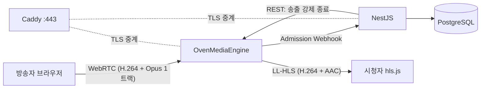
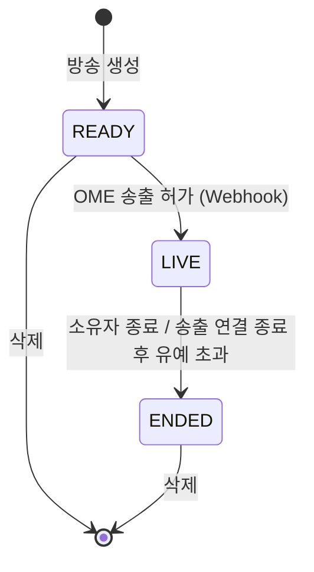
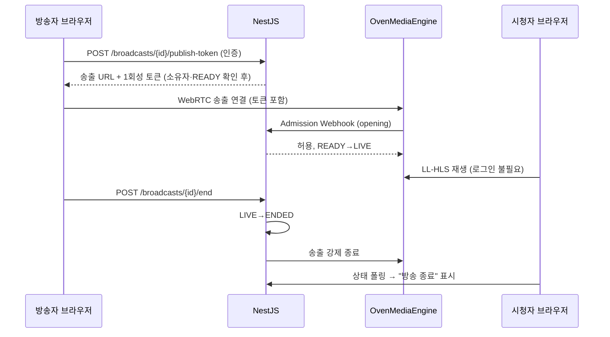

## Product Requirements Document: 실시간 방송 플랫폼

**Author**: keunhyeok
**Date**: 2026-11-09
**Status**: Draft
**마감**: 2026-11-19(목) 23:59 KST — 남은 기간 11일

---

### 1. Summary

브라우저만으로 PC(화면 공유 + 마이크 + 탭/시스템 소리)와 모바일(카메라 + 마이크) 라이브 방송을 송출하고, 누구나 로그인 없이 시청하는 웹 서비스를 만든다. 공모전 평가는 **필수 기능의 완결성과 서버 측 인가 검증**을 가장 크게 보므로, 1차 목표는 필수 4개 영역을 배포 URL에서 끊김 없이 시연하는 것이다. 선택 기능은 필수 기능이 끝난 뒤 비용이 낮은 순서로 붙인다.

### 2. Contacts

| 역할 | 이름 | 비고 |
|---|---|---|
| 개발·기획 | keunhyeok | 1인 개발 |
| 평가 | 공모전 심사자 | README만 보고 기능을 확인한다 |

### 3. Background

- **왜 지금**: 공모전 제출물이다. 심사자는 README에 적힌 URL과 테스트 계정으로 직접 송출·시청·종료를 해 본다. 접속이나 테스트 로그인이 안 되면 감점된다.
- **핵심 기술 제약**
  - 화면 공유 오디오(`getDisplayMedia({audio:true})`)는 브라우저와 OS에 따라 다르다. Chrome/Edge는 탭 소리를 모든 OS에서 지원하고, 시스템 소리는 Windows(및 ChromeOS)에서만 지원한다. Safari와 Firefox는 화면 공유 오디오를 지원하지 않는다.
  - 카메라·마이크·화면 캡처는 HTTPS에서만 동작한다. 배포 환경은 처음부터 HTTPS여야 한다.
  - 모바일 브라우저는 화면이 꺼지거나 앱이 백그라운드로 가면 캡처가 멈춘다.
- **송출 방식 비교**

| 방식 | 지연 | 다중 시청자 | 녹화 | 구현·운영 부담 | 판단 |
|---|---|---|---|---|---|
| WebRTC P2P(mesh) | 낮음 | 송출자 업로드가 시청자 수만큼 늘어 수 명에서 한계 | 어려움 | 시그널링 직접 구현 | 제외 |
| **OvenMediaEngine (자체 호스팅)** | LL-HLS 2~5초 / WebRTC 1초 미만 | 서버가 분배 | 서버 내장 | UDP 포트·TLS·코덱 직접 관리 | **채택** |
| WebRTC SFU (LiveKit Cloud) | 1초 미만 | SFU가 분배 | Egress(별도 비용) | SDK 제공, 외부 서비스 의존 | **복귀안** (8.1 컷 규칙) |
| MediaRecorder → WebSocket → FFmpeg → HLS | 5~15초 | 정적 서빙 | 쉬움 | 트랜스코딩 서버 직접 구현 | 제외 |

### 4. Objective

**목표**: 심사자가 README만 보고 10분 안에 PC·모바일 송출 → 다른 기기 시청 → 종료, 그리고 권한별 허용·거절을 모두 확인할 수 있다.

| Key Result | 측정 방법 | 목표 |
|---|---|---|
| KR1. 필수 시나리오 통과율 | 8.3 인수 시나리오를 배포 URL에서 수행 | 100% |
| KR2. 송출→시청 지연 | 송출 화면의 시계와 시청 화면을 나란히 촬영 | LL-HLS 5초 이하 |
| KR3. 인가 매트릭스 | 비로그인/소유자/타인 × 각 API를 자동 테스트로 검증 | 거절 케이스 전부 401/403 |
| KR4. 재시작 후 조회 | 서버 재시작 후 방송 목록·상세 조회 | 데이터 유실 0건 |
| KR5. 종료 시 송출 중단 | 종료 API 호출 후 시청 화면 | 10초 안에 재생 중단 + "종료됨" 표시 (LL-HLS 버퍼 포함) |

### 5. Market Segments

| 세그먼트 | 상황 | 대표 기기 |
|---|---|---|
| PC 방송자 | 게임·작업 화면을 소리와 함께 바로 송출하고 싶다. OBS 설치·설정은 부담이다 | Windows/macOS + Chrome/Edge |
| 모바일 방송자 | 밖에서 휴대폰 카메라로 바로 방송하고 싶다 | iOS Safari, Android Chrome |
| 시청자 | 링크만 받아 가입 없이 바로 보고 싶다 | 모든 기기 |
| 심사자 (1차 사용자) | 제한된 시간에 기능과 권한 검증을 빠짐없이 확인해야 한다 | PC 1대 + 휴대폰 1대 |

### 6. Value Propositions

**PC 방송자**
- **Who**: 화면을 공유하며 말로 설명하는 사람
- **Why**: 화면, 마이크, 게임/영상 소리를 한 번에 내보내야 한다
- **What before**: OBS 설치 → 장면·오디오 소스 설정 → 스트림 키 입력
- **How**: 브라우저에서 "방송 시작" → 화면/탭 선택 → "탭 소리 공유" 체크 → 마이크 허용
- **What after**: 설치 없이 30초 안에 화면+소리 방송이 켜진다
- **Alternatives**: OBS + 치지직/유튜브. 품질은 높지만 진입 장벽이 크다

**모바일 방송자**
- **Who**: 휴대폰만 들고 있는 방송자
- **Why**: 현장을 바로 보여주고 싶다
- **What before**: 전용 앱 설치·가입
- **How**: 모바일 브라우저에서 로그인 → 방송 생성 → 카메라·마이크 허용 → 시작 (전·후면 전환 지원)
- **What after**: 앱 없이 웹으로 즉시 송출한다
- **Alternatives**: 플랫폼 공식 앱

**시청자**
- **Who**: 링크를 받은 누구나
- **Why**: 가입 없이 바로 보고 싶다
- **What before**: 가입·로그인 요구에 이탈
- **How**: 목록에서 "LIVE" 방송 선택 → 바로 재생
- **What after**: 로그인 없이 수 초 지연으로 시청한다 (치지직과 같은 LL-HLS 방식)
- **Alternatives**: 기존 플랫폼

**심사자**
- **Who**: 공모전 평가자
- **Why**: 기능과 권한 검증을 빠르고 확실하게 확인해야 한다
- **What before**: 계정 만들고, 실행 환경 세팅하고, 시나리오를 추측
- **How**: README의 URL → "테스트 계정으로 로그인" 버튼(방송자 A / 사용자 B) → README 시나리오 순서대로 확인
- **What after**: 계정 생성 없이 소유자·타인·비로그인 케이스를 모두 재현한다
- **Alternatives**: 없음 (README 품질이 곧 평가)

### 7. Solution

#### 7.1 기능 범위

| 영역 | 기능 | 우선순위 |
|---|---|---|
| 인증 | 회원가입·로그인·로그아웃, 인증 상태 유지, 테스트 계정 원클릭 로그인 | P0 |
| 방송 관리 | 방송 생성(제목·설명)·수정·삭제, 목록(LIVE/종료 필터), 상세 | P0 |
| PC 송출 | 화면 공유 + 마이크 + 탭/시스템 소리, 시작·종료, 마이크 음소거 | P0 |
| 송출 사전 점검 | 마이크·화면 오디오 레벨 미터 2개, 화면 오디오 없음 경고 + "다시 선택", Chrome/Edge 외 브라우저 경고 (PRE-MORTEM T4) | P0 |
| 모바일 송출 | 카메라 + 마이크, 전·후면 전환, 시작·종료, Screen Wake Lock으로 화면 꺼짐 방지, 권한 거부 안내 화면 (T5) | P0 |
| 시청 | 비로그인 시청(LL-HLS), LIVE/ENDED 상태 표시, 상태 5초 폴링으로 종료 시 자동 중단 (T9) | P0 |
| 운영 | 자동 재기동, 다운 감시 알림, 녹화 디스크 상한, DB 일일 덤프 (T6, 7.10) | P0 |
| 댓글 | 방송별 댓글 작성·목록·수정·삭제, 작성자 권한 검증 | P1 |
| 녹화·다시보기 | OME 녹화 기능으로 저장, 목록·상세·재생 | P2 |
| 도네이션 | 테스트 결제, 서버 승인 검증, 멱등 적립, 방송별 내역·합계 | P2 |
| OBS 송출 | 채널 스트림 키로 OBS 송출. 브라우저 송출 완료 후 재검토 | P3 (보류) |

#### 7.2 아키텍처

| 구성 요소 | 선택 | 이유 |
|---|---|---|
| 미디어 서버 | OvenMediaEngine | 치지직과 같은 LL-HLS를 기본 지원하고, WebRTC 송출·시청·녹화까지 한 서버로 해결한다 |
| 백엔드 | NestJS (TypeScript) | Guard로 "로그인 확인 → 소유자 확인"을 선언한다. OME Admission Webhook을 받는다 |
| DB | PostgreSQL | 사용자, 채널, 스트림 키, 방송 기록 |
| 프론트 | React (TypeScript) + hls.js | 주력 스택. hls.js 저지연 모드로 LL-HLS를 재생한다 |
| 배포 | VPS 한 대 + Docker Compose + Caddy | 혼자 운영 가능한 최소 구성. Caddy가 TLS를 맡고 웹·API·OME 시그널링·LL-HLS를 한 도메인으로 중계한다 |

- **방화벽**: 443(TCP), OME WebRTC ICE용 UDP 포트 범위, 모바일망 대비 TURN(TCP) 포트를 연다. 정확한 포트는 OME 설정에서 확정한다.
- **코덱**: 송출은 **H.264로 고정**한다. 브라우저가 VP8을 보내면 영상 트랜스코딩이 필요해 VPS CPU가 버티지 못한다. 오디오는 Opus → AAC 변환만 OME가 한다 (CPU 부담 낮음).

#### 7.3 데이터 모델 (초안)

- `User` 1 : 1 `Channel` (스트림 키 보유, 재발급 가능)
- `Channel` 1 : N `Broadcast` (제목, 설명, 상태, 시작·종료 시각, 녹화 경로)
- 상세 스키마는 착수 시 설계 문서로 분리한다.

#### 7.4 방송 상태

- 상태 전이는 서버만 한다. 클라이언트는 요청만 보낸다.
- `LIVE`에서 삭제를 요청하면 서버가 먼저 종료 처리한 뒤 삭제한다.
- `ENDED`는 다시 `LIVE`로 돌아가지 않는다. 다시 방송하려면 새 방송을 만든다.
- **종료 시 송출 중단**: NestJS가 DB 상태를 `ENDED`로 바꾸고 OME 관리 API로 해당 스트림의 송출을 끊는다. 클라이언트가 협조하지 않아도 송출이 끊겨야 한다. (해당 API 존재 여부는 D1–D2 스파이크에서 확인)
- **재송출 차단**: 송출 허가 Webhook은 `READY` 방송에만 허용을 돌려준다. `ENDED` 방송으로 다시 연결하면 거절된다.
- **비정상 종료**: 송출자 탭이 닫히거나 네트워크가 끊기면 OME가 연결 종료를 Webhook으로 알린다. 유예 시간(예: 30초) 안에 다시 연결되지 않으면 `ENDED`로 바꾼다.
- **송출 연결 생성·종료 (클라이언트)**: 시작 시 WebRTC 송출 연결을 만들고, 종료(직접 종료·서버 강제 종료·페이지 이탈) 시 PeerConnection을 닫고 모든 미디어 트랙을 `stop()`한다. 브라우저의 "화면 공유 중"·카메라 표시등이 꺼지는 것까지 종료로 본다. 브라우저의 "공유 중지" 버튼을 누른 경우(트랙 `ended`)도 종료 API를 호출한다.
- **좀비 방송 정리 (T8)**: Webhook이 누락되거나 순서가 바뀔 수 있으므로, 30초마다 OME 스트림 목록과 DB의 `LIVE` 방송을 대조해 송출이 없는 방송을 유예 후 `ENDED`로 바꾼다. Webhook 처리는 멱등하게 만든다 (같은 이벤트가 두 번 와도 결과가 같다).
- **시청자 종료 감지 (T9)**: 시청 화면은 방송 상태를 5초마다 조회하고, hls.js 치명적 오류 때도 즉시 다시 조회한다. `ENDED`면 hls 인스턴스를 정리하고 "방송 종료"를 표시한다.

#### 7.5 인가 규칙

송출 권한은 **OME Admission Webhook**으로 강제한다. 브라우저는 소유자에게만 발급되는 송출 토큰을 송출 URL에 담아 OME에 연결하고, OME는 연결마다 NestJS에 허용 여부를 묻는다. NestJS가 토큰·소유자·방송 상태를 확인해 거절하면 송출이 시작되지 않는다. 시청은 로그인 없이 허용한다.

| 행위 | 비로그인 | 로그인(타인) | 소유자 |
|---|---|---|---|
| 방송 목록·상세 조회, 시청 | 허용 | 허용 | 허용 |
| 방송 생성 | 401 | 허용 | — |
| 방송 수정·삭제 | 401 | 403 | 허용 |
| 송출 토큰 발급·종료 | 401 | 403 | 허용 |
| OME 송출 연결 (Webhook 판정) | 거절 | 거절 | 허용 (READY 상태만) |
| 스트림 키 조회·재발급 (P3) | 401 | 403 | 허용 |
| 댓글 작성 (P1) | 401 | 허용 | 허용 |
| 댓글 수정·삭제 (P1) | 401 | 작성자만 | 작성자만 |
| 후원 (P2) | 401 | 허용 | 자기 방송 후원은 거절 |

#### 7.6 핵심 흐름

#### 7.7 오디오 처리

- LL-HLS는 오디오 트랙을 하나로 다루므로, **브라우저에서 Web Audio로 마이크와 화면 공유 오디오를 한 트랙으로 섞어** 송출한다.
- 마이크 음소거는 믹서의 마이크 입력 음량(GainNode)을 0으로 내려 구현한다.
- AudioContext는 사용자 클릭 전에는 멈춰 있으므로 "방송 시작" 클릭 핸들러 안에서 `resume()`한다. 안 하면 무음으로 송출된다 (T7).
- 송출 화면 미리보기는 음소거한다. 방송자가 같은 브라우저에서 자기 방송을 시청하면 기본 음소거 + 하울링 안내를 띄운다 (T7).
- 사용자가 화면 공유 창에서 "오디오 공유"를 체크하지 않아 오디오 트랙이 없으면 화면에 경고를 띄운다. 이 문제는 심사 중 가장 흔하게 생길 실패다.

#### 7.8 지원 환경 (README에 그대로 명시)

| 기능 | 지원 | 미지원·제한 |
|---|---|---|
| PC 화면 + 탭 소리 | Chrome/Edge (Windows, macOS) | Safari, Firefox: 화면 공유 오디오 없음 |
| PC 화면 + 시스템 소리 | Chrome/Edge (Windows) | macOS: 탭 소리만 |
| 모바일 송출 | iOS Safari 15+, Android Chrome | 화면 꺼짐·백그라운드 전환 시 송출 중단 |
| 시청 | hls.js 지원 브라우저, iOS Safari(네이티브 HLS) | — |

#### 7.9 보안·운영 기본값

- **세션 쿠키 (T10)**: Nest에 trust proxy를 설정하고 쿠키는 `Secure` + `HttpOnly` + `SameSite=Lax`. 로그인 API에 간단한 요청 횟수 제한을 건다.
- **문법 오류 없음 (평가 체크리스트 기본 항목)**: 프론트·백엔드 모두 TypeScript strict + ESLint. GitHub Actions에서 push마다 `tsc --noEmit`, lint, build, 테스트를 돌리고, 실패한 상태로 제출하지 않는다.
- **비밀값 (T11)**: 첫 커밋 전에 `.gitignore`, `.env.example`, gitleaks pre-commit 훅을 둔다. 테스트 계정 비밀번호와 OME API 토큰, 토스 시크릿 키는 환경변수로만 주입한다.
- **가용성 (T6)**: Compose 전 서비스 `restart: unless-stopped`, 부팅 시 Docker 자동 시작, UptimeRobot 무료 감시로 다운 시 메일 알림.
- **데이터 (T6)**: 녹화 저장 용량 상한과 오래된 파일 삭제, PostgreSQL 하루 1회 덤프. 복구 절차(명령어 몇 줄)를 README 운영 메모에 남긴다.

#### 7.10 Assumptions and open questions

| # | 가정 / 질문 | 검증 방법·시점 |
|---|---|---|
| A1 | 서버 한 대(ARM 2 OCPU / 12GB)가 오디오 변환과 심사 기간 트래픽(동접 6명 미만)을 감당한다 (가정) | D2 스파이크에서 송출 1개 + 시청 3개 기준 CPU·대역폭 측정 |
| A2 | **확정**: 백엔드 NestJS(TypeScript) + PostgreSQL, 프론트 React(TypeScript) + hls.js | ORM(Prisma/TypeORM)은 D1에 확정 |
| A3 | 인증 방식: 같은 도메인 배포를 전제로 세션 쿠키 (가정) | D1에 확정 |
| A4 | **확정**: Oracle Cloud Always Free (Ampere A1 ARM, 서울/춘천) 한 대 + Docker Compose + Caddy + DuckDNS 도메인. 목표 비용 0원 | D1에 인스턴스 생성, D2에 HTTPS 배포 |
| A5 | Oracle ARM 재고 부족("Out of capacity")으로 D1 안에 생성 못 하면 서울 리전 유료 VPS 2GB(시간 과금)로 대체한다 | D1 |
| A6 | 무료 계정의 유휴 인스턴스 회수를 막기 위해 종량제(PAYG) 계정으로 전환하고, 무료 범위 안에서만 쓴다. 심사 기간 내내 서버를 켜 둔다 | D1 전환, 결제 알림 0원 초과 시 알림 설정 |
| Q6 | OME 공식 Docker 이미지가 linux/arm64를 지원하는가. 미지원이면 ARM용 소스 빌드 | D1 |
| Q1 | 브라우저 WebRTC 송출을 H.264로 고정할 수 있는가 (OME 협상 설정) | D1–D2 스파이크 |
| Q2 | OME 관리 API로 특정 스트림의 송출을 강제로 끊을 수 있는가 | D1–D2 스파이크 |
| Q3 | LTE/5G망 휴대폰에서 UDP가 막힐 때 TURN(TCP)으로 송출되는가 | D2 스파이크 (실제 휴대폰, Wi-Fi 끄고) |
| Q4 | 도네이션 PG: 토스페이먼츠 테스트 모드 사용 가능 여부와 웹훅 수신 조건 | P2 착수 전 |
| Q5 | 송출 중 새로고침 시 같은 방송에 재접속을 허용할지 | 유예 시간 안 재접속은 허용하는 방향 |

### 8. Release

#### 8.1 일정 (11일)

| 기간 | 내용 | 완료 기준 |
|---|---|---|
| D1 (11/9) | 첫 커밋 전 비밀값 차단(T11), Oracle 서버 생성 **2시간 제한**(T2), 로컬 Nest·React 골격, **LiveKit Cloud 샘플을 대기 상태로 준비**(T1) | 서버 확보 또는 유료 VPS 전환 완료 |
| D2 (11/10) | Compose + Caddy HTTPS 배포, 자동 재기동·UptimeRobot(T6), **OME 스파이크**, 실제 휴대폰 LTE 테스트(T5) | **18:00에 스파이크 기준 판정** |
| D3–D4 (11/11–11/12) | 인증(테스트 계정, 세션 쿠키·요청 제한 T10), 채널·방송 CRUD, 상태 전이, 인가, Admission Webhook | 7.5 매트릭스 자동 테스트 통과 |
| D5 (11/13) | PC 송출(믹싱, AudioContext resume T7), **송출 사전 점검 화면(T4)**, 모바일 송출(Wake Lock T5) | PC·모바일 송출이 실제 기기에서 소리와 함께 나감 |
| D6 (11/14) | 시청, 종료·비정상 종료, 좀비 방송 정리(T8), 시청자 종료 감지(T9), 실제 기기 LTE 재확인 | 8.3 P0 시나리오 실제 기기 통과 |
| D7 (11/15) | P1 댓글 | 작성자 권한 테스트 통과 |
| D8–D9 (11/16–11/17) | P2 녹화(OME 내장 기능) → 여유 있으면 도네이션. 녹화 디스크 상한·DB 덤프(T6) | 해당 기능 시나리오 통과 |
| D10 (11/18) | README 마무리, 실제 기기 회귀 테스트, 시연 영상(선택), Go/No-Go 체크리스트 | 다른 사람이 README만 보고 재현 |

- **README는 기능 하나가 끝날 때마다 해당 절차를 같이 쓴다** (T13). D10에는 다듬기만 한다.
- 손에 없는 환경(예: Windows 시스템 소리, Android)은 README에 "미검증"으로 적는다. 지원한다고 쓰지 않는다.
- 선택 기능은 **댓글까지만 해도 성공**으로 본다. 녹화·도네이션은 보너스다.
| D11 (11/19) | 버퍼. 신규 기능 금지 | 23:00 전 최종 커밋 |

**OME 스파이크 통과 기준 (D2 종료 시점)**

1. 휴대폰(Wi-Fi 끈 LTE/5G)에서 Safari로 송출한 영상을 PC의 hls.js로 재생할 때 **영상과 소리가 모두** 나온다.
2. 송출 코덱이 H.264이고, 송출 1개 + 시청 3개에서 VPS CPU가 낮게 유지된다 (영상 트랜스코딩 없음).
3. Admission Webhook으로 토큰 없는 송출이 거절된다.
4. 관리 API로 송출을 강제 종료할 수 있다.

**컷 규칙**
- D2 18:00까지 스파이크 기준을 하나라도 통과하지 못하면 "조금만 더" 없이 **LiveKit Cloud로 복귀**한다. 이 경우 시청은 WebRTC, 녹화는 P2에서 제외한다.
- D6 끝까지 P0가 실제 기기에서 통과하지 않으면 P1·P2를 모두 미루고 P0 안정화에 쓴다.

#### 8.2 첫 버전에서 하지 않는 것 (Non-goals)

- OBS 송출: 브라우저 송출(P0)과 선택 기능을 마친 뒤 재검토한다. OME가 RTMP·WHIP 입력과 AAC→Opus 변환을 지원하므로, 채널 스트림 키만 있으면 붙일 수 있다
- 화질 선택·적응형 비트레이트(영상 트랜스코딩 필요 — VPS CPU 한계)
- 채팅 실시간 푸시 (P1 댓글은 조회·폴링으로 충분)
- 방송 예약, 팔로우·알림, 카테고리·검색
- 소셜 로그인, 비밀번호 찾기, 이메일 인증
- 네이티브 앱
- 종료된 방송 재개 (새 방송으로 대체)

#### 8.3 인수 시나리오 (README "기능 확인"의 뼈대)

1. 비로그인으로 목록 진입 → 방송 생성 버튼 클릭 → 로그인 페이지로 이동 (401)
2. 방송자 A 로그인 → 방송 생성 → PC에서 화면 + 탭 소리 + 마이크로 시작 → 상태 LIVE
3. 휴대폰(비로그인)에서 목록 → 해당 방송 시청 → 영상·탭 소리·마이크 모두 들림
4. 사용자 B 로그인 → A의 방송 수정·삭제·종료 시도 → 403 (UI 숨김 + API 직접 호출로도 확인)
5. A가 종료 → 시청 화면이 "방송 종료"로 바뀜 → 목록에서 ENDED 표시
6. 휴대폰에서 A로 로그인 → 카메라 방송 시작 → PC에서 시청 → 전·후면 전환 → 종료
7. 서버 재시작 → 목록·상세가 그대로 조회됨
8. 송출 중 방송자 탭을 강제로 닫음 → 유예 시간 뒤 ENDED로 바뀜
9. 종료된 방송의 송출 토큰으로 다시 송출 시도 → OME가 거절
10. PC 송출에서 "오디오 공유"를 체크하지 않고 화면 선택 → 사전 점검 화면에 경고 + "다시 선택" 표시
11. 모바일 송출 중 1분간 화면을 건드리지 않음 → 화면이 꺼지지 않고 송출 유지

위험 분석과 대응 근거는 [PRE-MORTEM.md](./PRE-MORTEM.md)를 따른다.

#### 8.4 선택 기능 메모 (착수 시 상세화)

- **도네이션 멱등성**: 결제 승인 키(paymentKey/orderId)에 UNIQUE 제약을 건다. 승인 통지가 반복되면 기존 건을 반환하고 다시 적립하지 않는다. 금액·후원 대상은 클라이언트 값이 아니라 서버가 미리 저장한 주문과 PG 조회 결과로 대조한다.
- **녹화**: 방송이 LIVE가 되면 OME 녹화를 시작하고, 종료 시 파일 경로를 `Broadcast`에 저장한다. 녹화 파일은 Docker 볼륨에 두고 Caddy로 정적 서빙한다. 다시보기 목록은 `ENDED` 상태이면서 녹화 파일이 있는 방송만 보여준다.
