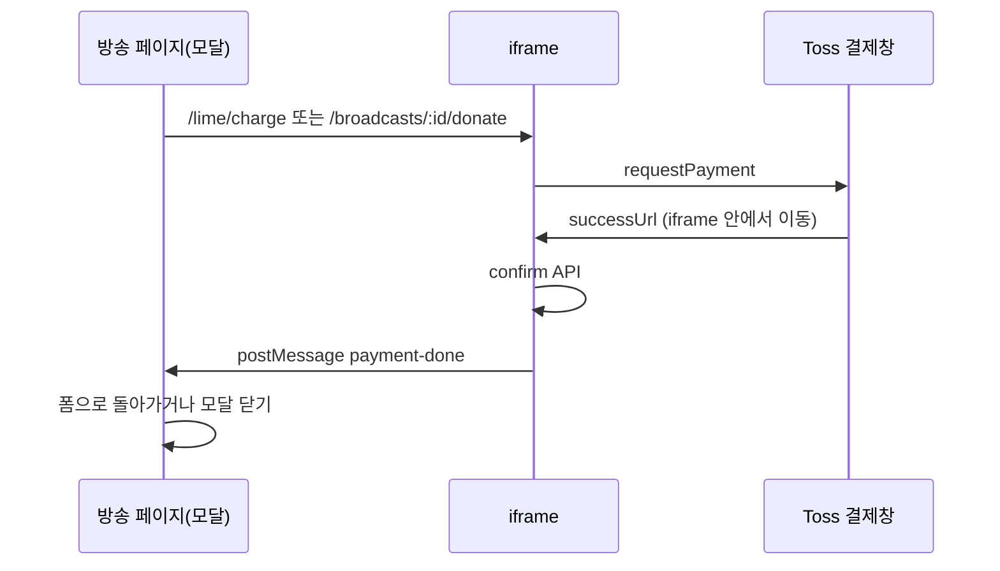

## Product Requirements Document: 후원 모달과 PC 결제 화면 유지

**Author**: kh.jeon
**Date**: 2026-11-15
**Status**: 1단계 구현 완료 (2026-11-15, #180: #183). 2단계 #181은 스파이크 #179 대기

## 1. Summary

넓은 화면에서는 "후원하기"를 누르면 후원 폼을 모달로 띄운다. 패널에는 합계와 순위만 남긴다. PC에서는 충전과 카드 후원 결제도 그 모달 안 iframe에서 끝낸다. 그래서 결제하는 동안 방송 화면이 그대로 보인다. 모바일과 좁은 화면은 지금처럼 시트 안 폼과 새 탭 결제를 쓴다.

근거는 [DISCOVERY](./DISCOVERY-donation-modal.md)와 [RED-TEAM](./RED-TEAM-donation-modal.md)이다.

> **PRD-lime §7.1·7.3과 어긋남**: 두 절은 "충전하기"와 "카드로 후원"을 새 탭으로 연다고 정했다. 이 문서는 PC에서 그 결제를 모달 안 iframe으로 옮긴다. 이유는 3장 "도입 판단"에 있다. 구현 PR은 본문에 이 사실을 쓰고, PRD-lime과 `apps/web/CLAUDE.md`의 시청 화면 행을 고친다.

## 2. Contacts

| 이름 | 역할 |
|---|---|
| kh.jeon | 1인 개발 (기획·구현·검증) |

## 3. Background

- 지금 시청 화면 후원 패널에는 라임 후원 폼이 늘 펼쳐져 있다. "후원하기" 버튼은 카드 결제 탭(`/broadcasts/:id/donate`)을 바로 연다.
- 잔액이 모자라면 "충전하기"와 "카드로 후원"이 `window.open(..., '_blank')`로 새 탭을 연다. 방송 탭 영상은 멈추지 않는다. 하지만 브라우저가 새 탭으로 화면을 넘긴다. 그래서 사용자는 "방송 화면을 이탈한다"고 느꼈다(2026-11-15 사용자 피드백).
- 사용자가 정한 방향: 후원 폼은 모달로 띄운다. PC 결제는 모달 안 iframe으로 열고, 모바일은 새 탭을 유지한다.
- **발견·레드팀 결과 (2026-11-15)**
  - 토스페이먼츠 기술 문의 답변은 iframe 안 결제창을 권장하지 않는다. 이유는 Chrome CORS 차단이다. 다만 약 1년 전 답변이다. SDK 2.10.0에서 실제로 되는지 직접 확인해야 한다(E1).
  - 결제 페이지는 모두 `AppLayout` 안에 있다. 그대로 iframe에 넣으면 헤더가 한 번 더 그려진다.
  - 좁은 화면의 후원 패널은 이미 `ActionSheet`(모달 `dialog`) 안에 있다. 여기에 모달을 또 띄우면 모달이 겹친다.
- 마감은 2026-11-19 23:59 KST다. 11-17~18은 실기기 회귀(#17)에 쓴다.

### 도입 판단

1. **지금 겪는 문제**: PC에서 충전이나 카드 후원을 누르면 화면이 새 탭으로 넘어간다. 방송을 보던 사람은 결제하는 동안 방송을 보지 못한다. 결제가 끝나면 탭이 닫히며 돌아오지만, 그동안은 방송을 떠난 것처럼 보인다.
2. **대안과 안 쓰는 이유**
   - 방송 페이지에서 Toss 결제창을 직접 띄우기: 결제가 성공하면 `successUrl`로 방송 페이지 전체가 이동해 영상이 끊긴다.
   - 지정 크기 팝업 창: Toss 지원 범위 안이다. 하지만 별도 창이라 방송 화면 일부를 가린다. 팝업 차단 안내도 필요하다. iframe이 실패할 때의 대안(8.1)으로 남긴다.
   - 결제 중 PiP: 브라우저마다 진입 조건이 다르다. 범위가 크다.
3. **가능해지는 것**: PC에서 후원의 모든 경로(라임 후원, 충전, 카드 후원)가 방송 화면 위에서 끝난다.
4. **비용·한계**
   - Toss가 권장하지 않는 사용법에 기대야 한다. 그래서 E1 스파이크를 통과해야만 진행한다.
   - 결제 화면 6개(충전·카드 후원 각각의 결제, 성공, 실패)가 iframe 안에서 열릴 때의 동작을 더한다.
   - 모바일과 PC가 다른 결제 경로를 쓴다. 회귀 확인이 두 갈래가 된다.

## 4. Objective

심사위원이 PC에서 후원 기능을 써 볼 때, 결제 때문에 방송 화면을 떠나지 않게 한다. 평가 기준의 "기능 완성도"에 닿는 부분은 후원 흐름의 매끄러움이다.

| KR | 측정 | 목표 |
|---|---|---|
| KR1 | PC Chrome·Safari에서 충전 1회, 카드 후원 1회를 하는 동안 방송 탭 URL과 영상 `currentTime` | URL 변화 0회, `currentTime` 계속 증가 |
| KR2 | 넓은 화면에서 "후원하기" → 라임 후원 완료까지 페이지 이동 | 0회 |
| KR3 | 1366×768 창에서 모달 안 Toss "결제하기" 버튼까지 도달 | 스크롤로 닿는다 |
| KR4 | 좁은 화면(360px)과 모바일의 기존 후원 흐름 | PRD §8.3 15·16 그대로 통과 |

## 5. Market Segment(s)

- **심사위원(PC)**: Windows PC나 MacBook에서 시청 화면을 열고 후원을 시험한다. 라임이 0이라 대개 충전부터 한다.
- **심사위원(모바일)**: Android·iPhone에서 시트를 열고 후원한다. 이번 변경으로 바뀌지 않는다.
- 실사용자 데이터는 없다. 근거는 사용자 피드백과 치지직·Twitch의 공개 동작이다. 두 서비스 모두 후원 입력을 방송 화면 위 레이어로 띄운다.

## 6. Value Proposition(s)

- **Who**: PC로 방송을 보며 후원해 보는 심사위원
- **Why**: 후원 기능이 방송 경험을 끊지 않는지 확인하고 싶다
- **What before**: 늘 펼쳐진 폼이 패널을 차지한다. 충전이나 카드 후원을 누르면 새 탭으로 화면이 넘어간다
- **How**: "후원하기"가 모달을 띄운다. 충전과 카드 결제도 그 모달 안에서 진행한다
- **What after**: 결제하는 내내 모달 뒤로 방송이 보인다. 충전이 끝나면 같은 모달에서 바로 라임으로 후원한다
- **Alternatives**: 새 탭에서 결제하고 돌아오기(지금 방식)

## 7. Solution

### 7.1 화면 갈래

어느 갈래로 그릴지는 `BroadcastPage` 한 곳에서 정한다.

| 조건 | 후원 폼 | 충전·카드 결제 |
|---|---|---|
| 넓은 화면(`useWideScreen`, 1024px 이상)이고 `(pointer: fine)` | 모달 | 모달 안 iframe |
| 넓은 화면이고 `pointer: fine` 아님(터치 태블릿) | 모달 | 새 탭(지금과 같음) |
| 좁은 화면 | `···` 시트 안에 펼친다(지금과 같음) | 새 탭(지금과 같음) |

- 좁은 화면은 바꾸지 않는다. 시트가 이미 모달이므로 그 위에 모달을 겹치지 않는다(RED-TEAM 4).
- 판별 기준을 화면 폭과 `pointer: fine`의 조합으로 좁혔다. 이유는 Toss가 모바일 결제창으로 판단할 기기에서 iframe 결제를 피하기 위해서다(RED-TEAM 5). 마우스를 연결한 태블릿은 한계로 남긴다.

### 7.2 후원 모달 (넓은 화면)

- 패널 머리의 "후원하기" 버튼은 그대로 둔다. 누르면 새 탭 대신 모달을 연다. 패널 본문에서 `LimeDonationForm`을 뺀다. 패널에는 합계·건수·"후원이 반영되었습니다"·순위만 남는다.
- 모달은 네이티브 `<dialog>`의 `showModal()`을 쓴다(`ActionSheet`와 같은 방식). 제목은 "후원하기"이고 닫기 버튼이 있다. Esc, 바깥 클릭, 닫기로 닫힌다. 닫히면 포커스는 "후원하기"로 돌아간다.
- 모달 본문은 지금의 `LimeDonationForm`이다. 동작과 문구는 바꾸지 않는다. 다만 "카드로 후원"은 잔액과 관계없이 늘 보조 버튼으로 둔다. 지금 "후원하기"가 하던 카드 후원 진입을 잃지 않기 위해서다.
- 라임 후원에 성공하면 모달을 닫는다. 패널에 "후원이 반영되었습니다"를 띄운다.

### 7.3 모달 안 결제 (PC)

- "충전하기"나 "카드로 후원"을 누르면 모달 본문이 결제 보기로 바뀐다. 결제 보기는 위에 "뒤로"(폼으로 돌아간다), 아래에 iframe(`/lime/charge` 또는 `/broadcasts/:id/donate`)이다.
- 모달 크기: 결제 보기일 때 폭과 높이를 Toss PC 결제창이 들어갈 만큼 키운다. 값은 토큰으로 정하고 E4에서 잰다. 화면보다 크면 iframe 안에서 스크롤한다.
- **iframe 안 표시**: 결제 화면 6개(`/lime/charge`, `/lime/charge/success`, `/lime/charge/fail`, `/broadcasts/:id/donate`, `/donations/success`, `/donations/fail`)가 iframe 안에서 열렸으면(`window.self !== window.top`), `AppLayout`은 헤더·팔로우 패널·영역 메뉴를 그리지 않고 본문만 그린다. 쿼리 파라미터를 쓰지 않으므로 Toss가 보내는 `successUrl`·`failUrl`에도 그대로 적용된다. 다른 화면은 iframe 안이어도 그대로 그린다. 앱 전체를 다른 사이트가 iframe으로 띄워도 헤더가 사라지지 않게 하기 위해서다(PRE-MORTEM T3).
- **완료 알림**: iframe 안의 성공 페이지는 confirm에 성공하면, 지금처럼 `BroadcastChannel`로 알리는 것에 더해 부모에게 `postMessage({ type: 'payment-done', kind: 'charge' | 'donation' })`를 보낸다. 대상 출처는 `location.origin`으로 고정한다. 부모는 `event.origin`과 `event.source`(자기 iframe)를 확인한 뒤에만 처리한다.
  - `charge`: 결제 보기를 닫고 폼으로 돌아간다. 폼은 새 잔액을 읽고 "N라임을 충전했습니다."를 한 줄 띄운다.
  - `donation`: 모달을 닫고 패널에 "후원이 반영되었습니다"를 띄운다.
- **돌아가기 버튼**: 성공·실패 페이지의 "돌아가기"·"방송으로 돌아가기"는 iframe 안이면 `window.close()` 대신 부모에게 `postMessage({ type: 'payment-close' })`를 보낸다. 부모는 결제 보기를 닫고 폼으로 돌아간다.
- **iframe 안 링크**: 성공·실패 페이지의 "다시 충전하기"·"다시 후원하기"는 iframe 안에서 그대로 이동해도 된다. "방송 목록으로 가기"처럼 결제 밖으로 나가는 링크는 iframe 안에서 숨긴다.
- **중간에 닫기**: 결제 보기에서 모달을 닫으면 묻지 않고 닫는다. Toss 결제는 서버 confirm 전까지 승인되지 않는다. 그래서 중간에 닫혀도 돈이 빠지지 않는다. 남은 주문은 지금처럼 결제 전 상태로 남는다.
- 서버, Toss 연동(`tossWidget`·`PaymentStep`), confirm API, 멱등 적립은 바꾸지 않는다.

### 7.4 Assumptions and open questions

| 가정·질문 | 확인 방법 |
|---|---|
| Toss 위젯과 결제창이 우리 iframe 안에서 PC 카드 테스트 결제를 끝까지 마친다(RED-TEAM 1) | E1: PC Chrome·Safari 테스트 결제 1회씩. PIN은 사용자가 입력 |
| 결제 뒤 이동이 iframe 안에 머물고, 방송 탭 URL은 바뀌지 않는다 | E1에서 방송 탭 URL과 `currentTime` 기록 |
| 기본 `windowTarget`으로 안 되면 `'self'`로 된다 | E2 |
| Toss 결제창이 1366×768 모달 안에서 잘리지 않는다 | E4 스크린샷 |
| 간편결제(토스페이·카카오페이) 팝업이 iframe 안에서 동작한다 | 확인하지 않는다. 심사 시나리오는 카드 테스트 결제다. README 한계에 적는다 |

## 8. Release

### 8.1 순서와 컷 규칙

| 단계 | 내용 | 완료 기준 |
|---|---|---|
| 0 | E1·E2·E4 스파이크. `BroadcastPage`에 임시 dialog + iframe을 넣고 PC Chrome·Safari에서 충전 테스트 결제를 한다. 코드는 머지하지 않는다 | 통과·실패 판정을 이슈 댓글에 남긴다 |
| 1 | 후원 모달(7.2). E1 결과와 관계없이 진행한다. 결제는 아직 새 탭이다 | 시나리오 30, KR2 |
| 2 | 모달 안 결제(7.3): iframe 안 표시, `postMessage` 완료·닫기, 갈래 판별 | 시나리오 31·32, KR1·KR3 |

- **E1이 Chrome·Safari 중 하나라도 실패하면** 2단계를 팝업 창으로 바꾼다. `window.open(url, 'lime-payment', 'width=…,height=…')`이고, 결제 탭의 `window.close()` 복귀를 그대로 쓴다. 이 경우 PRD-lime과 어긋나지 않으므로 위 인용 상자를 지운다.
- **11-16 끝까지 0단계를 끝내지 못하면** 2단계를 접는다. 1단계만 내고, PC 결제는 새 탭으로 둔다.
- 1단계는 반나절, 2단계는 하루로 본다. 11-17~18은 #17에 쓴다. 2단계가 11-17 오전에 머지되지 않으면 접는다.
- 단계마다 `apps/web/CLAUDE.md` 시청 화면 행과 README "기능 확인" 10절을 같이 고친다.

### 8.2 첫 버전에서 하지 않는 것

- 좁은 화면과 모바일의 후원 흐름 변경
- 간편결제 수단의 iframe 검증
- 터치 태블릿에서의 iframe 결제
- 결제 중 모달 닫기 확인창
- 서버, Toss 연동, confirm API 변경

### 8.3 인수 시나리오 (PRD 8.3에 이어 붙인다)

30. PC 넓은 화면, B로 A의 LIVE 방송 → 패널에는 합계와 순위만 있고 폼은 없다 → "후원하기" → 모달에 잔액·금액·메시지·"라임으로 후원"·"카드로 후원"이 보인다 → Esc → 모달이 닫히고 포커스는 "후원하기"에 있다
31. PC Chrome, 라임 0인 B → 모달에서 1,000라임 선택 → "충전하기" → 같은 모달 안에서 10,000라임 테스트 결제 → 결제 보기가 닫히고 폼에 "잔액 10,000라임" → "라임으로 후원" → 모달이 닫히고 "후원이 반영되었습니다". 처음부터 끝까지 방송 탭 URL은 그대로이고 영상은 멈추지 않는다. Safari도 같다
32. PC Chrome, 모달에서 "카드로 후원" → 같은 모달 안에서 5,000원 테스트 결제 → 모달이 닫히고 "후원이 반영되었습니다", 채팅에 후원 줄. 결제창을 닫으면 "결제를 취소했습니다."가 모달 안에 보이고 "돌아가기"로 폼에 돌아온다
